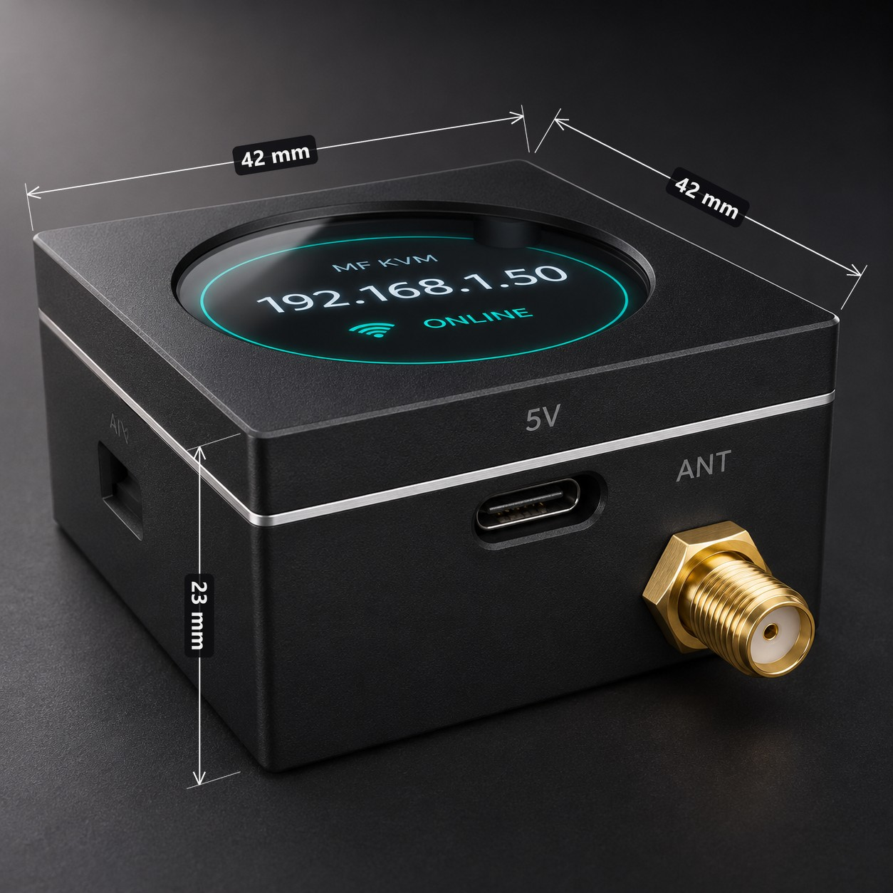
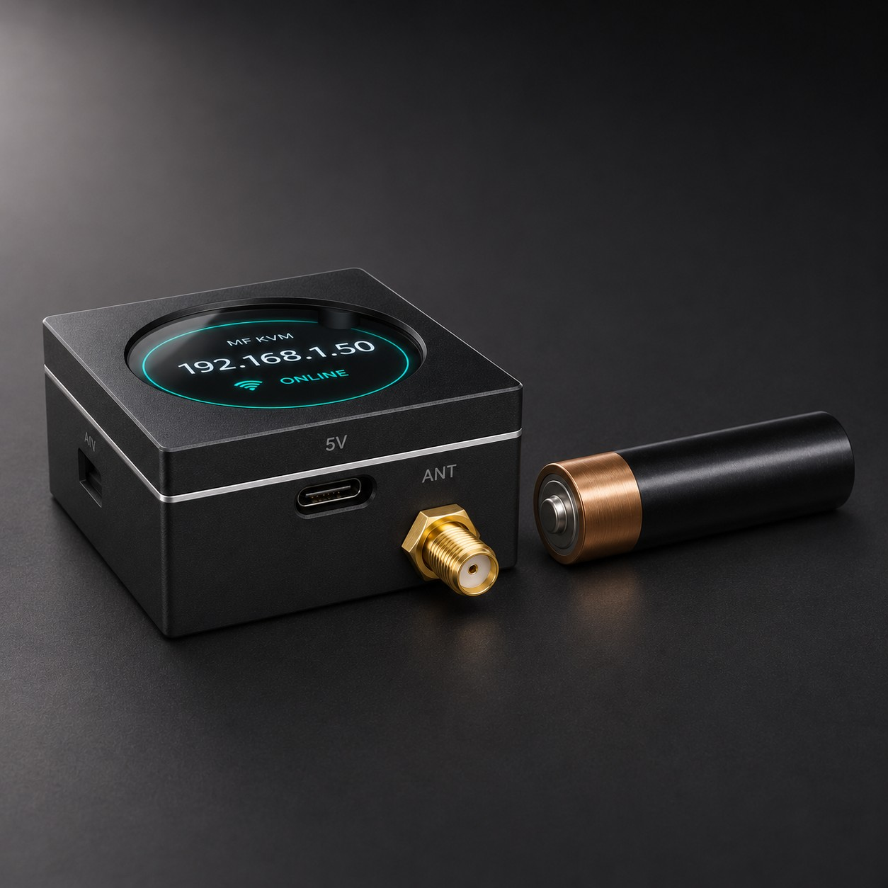
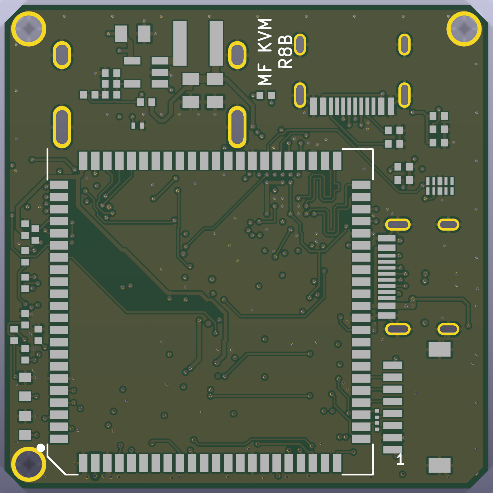
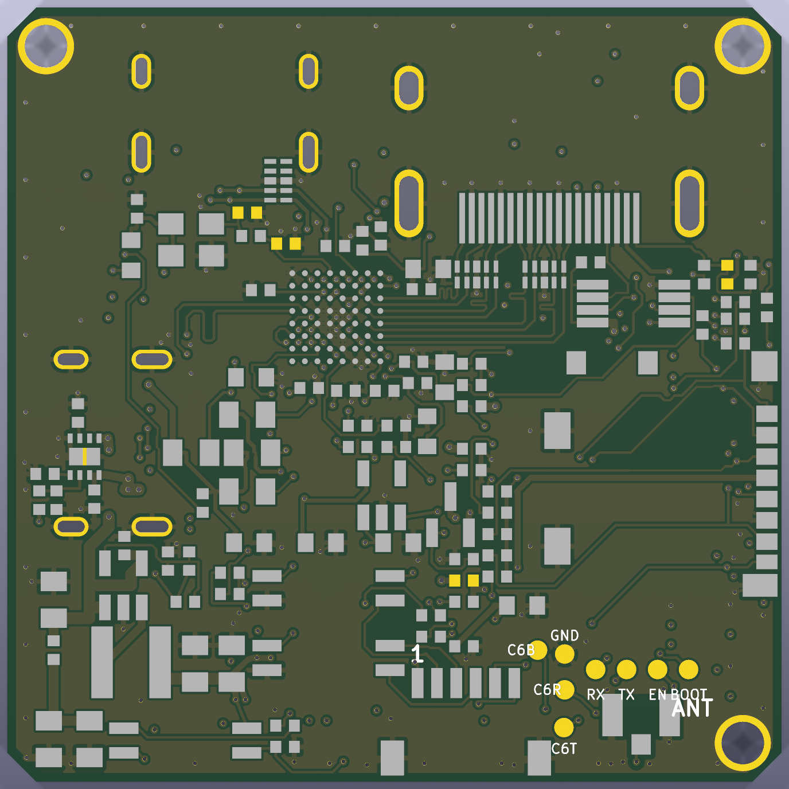
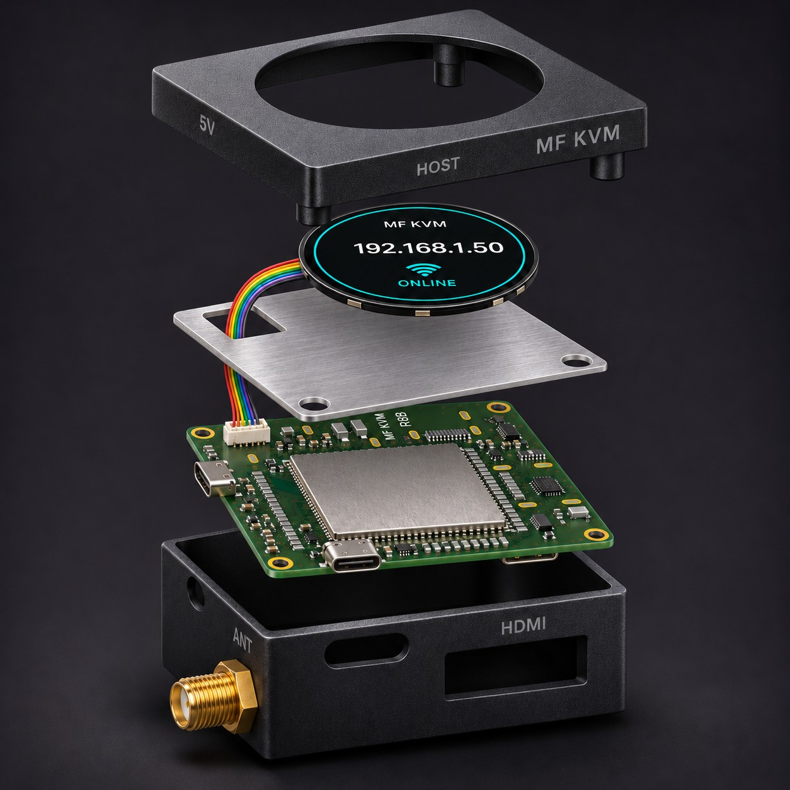

# MF KVM

[繁體中文](README.md) | **English**

MF KVM is a small KVM-over-IP box built around the ESP32-P4 and running the [ESP-KVM](https://github.com/espkvm/espkvm) firmware. Plug in a host's HDMI and USB, then see its screen and use its keyboard and mouse from a browser over Wi-Fi. It can also press the host's power and reset buttons.

**Status: r8b was ordered for fabrication on 2026-11-16 and the boards have not arrived.** Nothing has been soldered or powered. Everything that has passed is a file-level or model-level check. Nothing has been verified on hardware.

Licensed under [LICENSE](LICENSE): hardware CERN-OHL-P-2.0, software Apache-2.0, documentation CC-BY-4.0. Third-party content keeps its own terms; see [THIRD_PARTY.md](THIRD_PARTY.md).

## Current revision: r8b

One 6-layer board, 40 × 40 mm, with parts on both sides. The controller is an ESP32-P4-Module (U1, hand-soldered after assembly) and video goes through a TC358743 (U7, BGA). The case is all aluminium with no fan, 42 × 42 × 23 mm, and the Wi-Fi antenna is external.

| Case and size | Next to an AA battery |
|---|---|
|  |  |

**These two pictures and the exploded view below are AI-generated illustrations, not photos. Nothing has been built yet.** They were redrawn from the engineering renders of the case, so the outline, the openings and the labels follow the engineering drawings, and the dimension lines were drawn on afterwards by a script. The screen content, the small parts on the board, the materials and the lighting are illustrative; for detail rely on [`case/stl/`](lay-board/r8b/case/stl/) and the Gerbers. The engineering renders are in the [r8b notes](lay-board/r8b/README.md).

| Top | Bottom |
|---|---|
|  |  |

Part reference table (click to expand)

**Top**

| Ref | What it is | Purpose / note |
|---|---|---|
| U1 | ESP32-P4 module | Controller and Wi-Fi; bought separately, hand-soldered after assembly; largest heat source |
| J3 | USB-C | To the controlled host (keyboard, mouse, virtual media) |
| J5 | USB-C | 5 V power, flashing, console |
| J6 | SM08B 8-pin | Round LCD |
| U14 | ESD protection | USB lines of J5 |
| U15 + L2 | Buck converter | 3V3 to 1.2 V |
| D1 | ESD protection | HDMI CEC |

**Bottom**

| Ref | What it is | Purpose / note |
|---|---|---|
| J2 | HDMI | Video input |
| U7 | TC358743 BGA | HDMI to CSI; the hottest chip |
| J7 | microSD | Virtual media and storage |
| U16 | TPS259531 eFuse | 5 V input protection; check its orientation when ordering |
| U2 + L1 | Buck converter | 5 V to 3V3 |
| U4 | LDO | 3V3 to 2.5 V |
| U6 | TCA9517A | HDMI DDC level shifter |
| U3, U8, U9 | ESD protection | USB lines of J3, HDMI TMDS |
| U10, U11, U12 | Optocoupler | ATX power, reset, LED |
| J4 | SM06B 6-pin | ATX front panel |
| J8 | U.FL | Wi-Fi antenna (a cable takes it to an SMA jack on the case) |
| Y1 | 27 MHz oscillator | Clock for U7 |
| Q1 | P-channel MOSFET | microSD power switch |
| R68 + C72, C73 | 0.47 Ω and two 22 µF | 5 V damping; replaces the 330 µF C69 of r7f |

Resistors and most capacitors are not listed; see [`BOM_JLC.csv`](lay-board/r8b/fab_r8b/BOM_JLC.csv) for the full list.

The two board pictures are rendered from the board file, not photos. The board file has no 3D models, so parts are boxes drawn from their real outlines and heights.

Exploded illustration (AI-generated). From top to bottom: lid, round LCD, aluminium heat spreader plate, circuit board, tray. The display cable passes through the rectangular cut-out in the plate to J6 at the corner of the board.

| Item | Specification |
|---|---|
| Board | 40 × 40 mm, 6 layers, 1.2 mm, JLC06121H-3313, three mounting holes |
| Case | 42 × 42 × 23 mm, CNC 6061 aluminium, black anodised, no fan |
| Surface temperature (model) | About 51.5 °C at most, at 25 °C ambient and typical load |
| Controller | ESP32-P4-Module base version (SKU 28101, 16MB, antenna on the castellated pin), with ESP32-C6 on board, 2.4 GHz Wi-Fi |
| Antenna | U.FL on the board, cable to an SMA jack in the left wall of the case, external antenna |
| Video | TC358743XBG, HDMI to CSI |
| Display | 1.28 inch round LCD (optional) |
| Power | USB-C, 1.5 A or more |
| Fab package | [`lay-board/r8b/fab_r8b/`](lay-board/r8b/fab_r8b/), Gerber zip sha256 starts with `3613530e` |

### What changed since r7f

| Item | Change |
|---|---|
| Board size | 40 × 45 to 40 × 40 mm; mounting holes 4 to 3 |
| 5 V damping | The 330 µF C69 is removed, R68 becomes 0.47 Ω, and C72 and C73 (22 µF 0805) are added |
| Case | From an aluminium lid, plastic tray and external fan duct to all aluminium with no fan, 42 × 42 × 23 mm |
| Antenna (r8b) | Now external: an SMA hole in the left wall, and a U.FL to SMA cable to J8 on the board underside |
| Edge clearance (r8b) | The two SD_CMD vias and the ATX_LED trace moved to 0.40 mm or more from the board edge |
| Vertical clamping (r8b) | The lid posts no longer press on the board; foam washers do |
| HDMI opening (case, 2026-11-16) | From a rectangle to the outline of the HDMI receptacle, narrow edge up, because the receptacle is on the underside of the board. The board is unchanged |

The TMDS, CSI and USB routing is the same as r7f. From r8 to r8b no part moved, the BOM and CPL are unchanged, and only 4 of the 108 nets have different copper.

**The fabricator changed the width of the impedance-controlled traces:** 100 Ω pairs from 5.0/7.8 to 4.7/8.1 mil, and the 90 Ω USB pair from 7.09 to 6.37 mil wide, with the pitch and the stack-up unchanged. So these traces on the physical board differ from the Gerbers in this repo. Put back into this project's solver, they all stay within ±10 %; see [`IMPEDANCE_AS_BUILT.md`](lay-board/r8b/IMPEDANCE_AS_BUILT.md) (in Chinese).

### How far verification has gone

| Passed (file and model level) | Result |
|---|---|
| ERC, DRC | ERC passes; DRC 0 errors, 0 unconnected, 29 warnings each accepted |
| Electrical rules, hot-plug, input filter, reference planes, pair gap, CSI vias, hand-solder clearance, impedance, part bodies | All pass |
| Board mutation tests | 124 of 124 caught |
| Case geometry | 126 checks pass; all 25 mutation runs (1 control, 24 faults) behave as expected |
| Independent review (r8) | Board conditionally ready to send. The 1 critical and 3 major case findings were fixed in r8b or closed by an owner decision. r8b did not get another independent review |

**Not verified:** there is no physical board yet. EMI, RF / RSSI, video, USB, Wi-Fi and temperatures are all untested. The thermal model was not rerun for r8b. The firmware has only been compiled, never flashed. The antenna cable, antenna, foam washers and thermal materials have no part numbers chosen yet.

**Where it stands:** ordered on 2026-11-16, waiting for the boards. First power-up follows [`BRINGUP_CHECKLIST.md`](lay-board/r8b/BRINGUP_CHECKLIST.md).

**Full details (in Chinese):** [r8b notes](lay-board/r8b/README.md), [R8B report](lay-board/r8b/R8B_REPORT.md), [R8 report](lay-board/r8b/R8_REPORT.md), [independent review](lay-board/r8b/REVIEW_r8.md), [thermal analysis](lay-board/r8b/thermal/THERMAL_R8.md). The previous revision, r7f, stays in [`lay-board/r7f/`](lay-board/r7f/README.md).

## Earlier designs (archive)

Kept as history. They are not the current revision.

| | [`off-the-shelf/`](off-the-shelf/README.md) | [`lay-board/`](lay-board/README.md) (r5) |
|---|---|---|
| Approach | Off-the-shelf FireBeetle 2 ESP32-P4 and Geekworm C790, with a small 2-layer ATX board | One custom 6-layer board with a BGA, the path that became r7f |
| Case | 75.0 × 38.05 × 26.73 mm, 76 cm³ | 44 × 44 × 20 mm, 39 cm³ |
| Status | Design only, parts not bought | Superseded; the r5 order was cancelled |
| Firmware | ESP-KVM `0893eef` with patches, compiled only | ESP-KVM `0893eef` with patches, compiled only |

The rest of the older material, including the build and check commands, is described in the [Chinese README](README.md).
