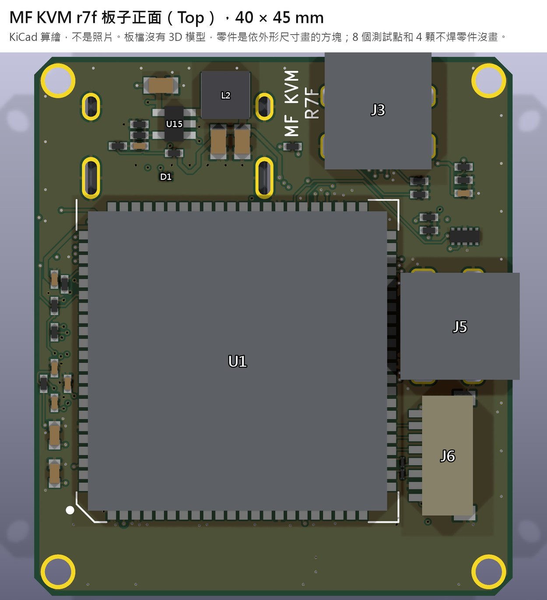
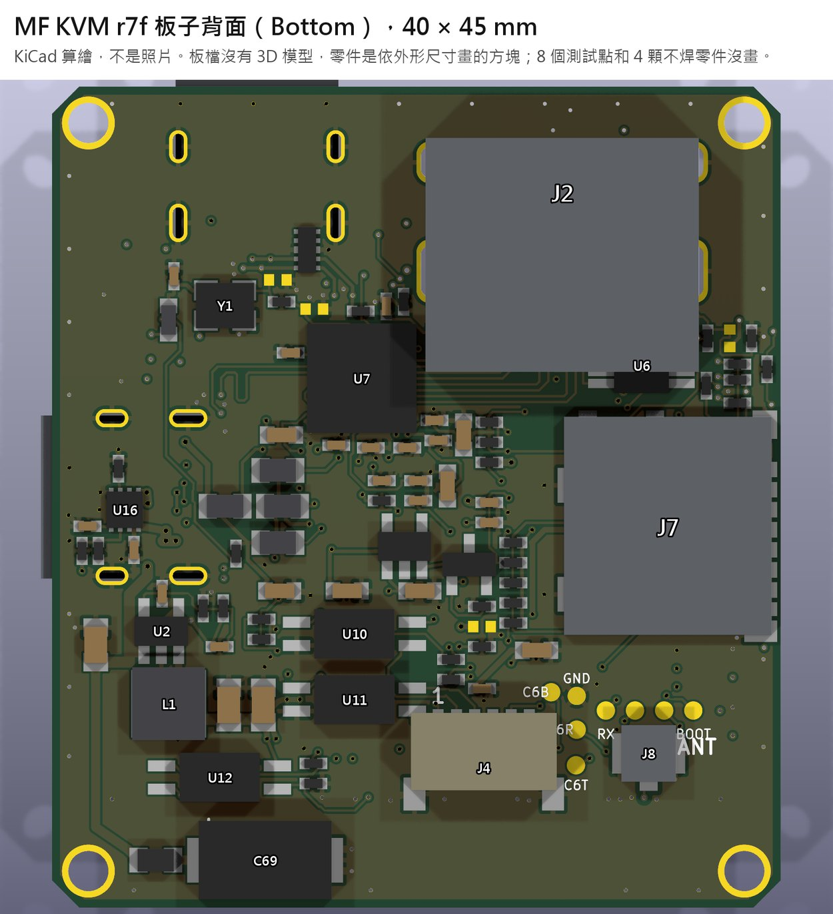
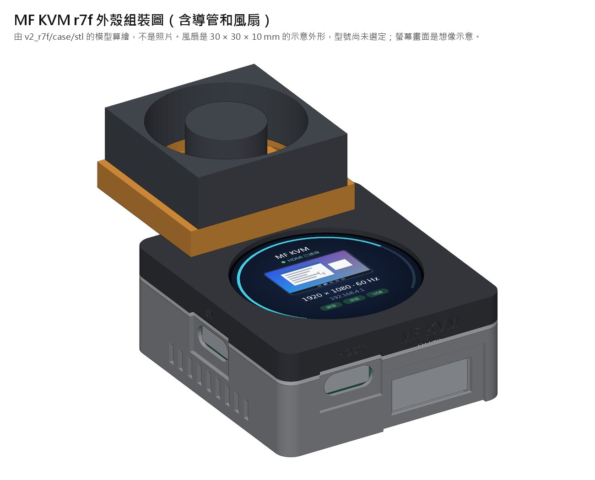
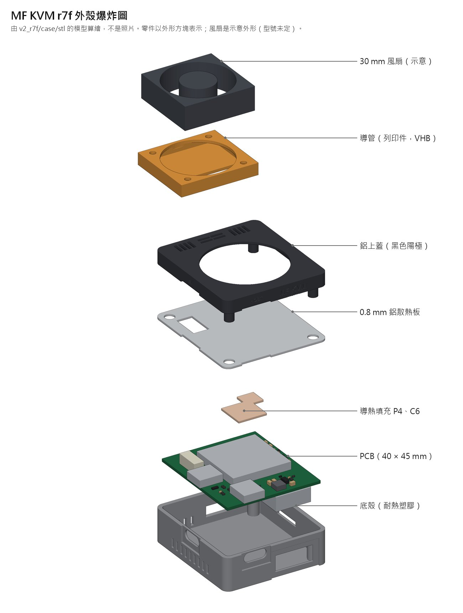

# MF KVM

[繁體中文](README.md) | **English**

MF KVM is a small KVM-over-IP box built around the ESP32-P4 and running the [ESP-KVM](https://github.com/espkvm/espkvm) firmware. Plug in a host's HDMI and USB, then see its screen and use its keyboard and mouse from a browser over Wi-Fi. It can also press the host's power and reset buttons.

**Status: no unit has been built yet.** The current revision, r7f, is in fabrication review at JLCPCB, unpaid. Everything that has passed is a file-level or model-level check. Nothing has been verified on hardware.

No license has been chosen; all rights reserved. Third-party content is listed in [THIRD_PARTY.md](THIRD_PARTY.md).

## Current revision: r7f

A single 6-layer board with parts on both sides. The controller is an ESP32-P4-Module (U1, hand-soldered after assembly) and video capture is a TC358743 (U7, BGA).

| Top | Bottom |
|---|---|
|  |  |

| Case assembled | Exploded |
|---|---|
|  |  |

These are renders, not photos. The board file has no 3D models, so parts are boxes drawn from their real outlines and heights, and the fan is a placeholder shape. Labels inside the images are in Chinese.

| Item | Spec |
|---|---|
| Board | 40 × 45 mm, 6 layers, JLC06121H-3313 |
| Case body | 44 × 49 × 20 mm, aluminium lid, tray in ASA / ABS / PC / PA12 (not PLA) |
| With duct and fan | 44 × 69.2 × 35 mm (10 mm fan thickness is assumed) |
| Rated ambient | 25 °C, with the ducted fan fitted |
| Controller | ESP32-P4-Module base model (SKU 28101), on-module ESP32-C6, 2.4 GHz Wi-Fi, external antenna on U.FL |
| Video | TC358743XBG, HDMI to CSI |
| Display | 1.28-inch round LCD |
| Fab package | [`lay-board/r7f/fab_r7f/`](lay-board/r7f/fab_r7f/), Gerber zip sha256 starts with `5edbd116` |

### What changed in this revision (from r7e)

All figures below come from models, not measurements.

| Area | Change | Result |
|---|---|---|
| 5 V input protection | Added eFuse U16 (TPS259531), about 2 A current limit, 5.7 V output clamp | Plug-in peak current from 10–18 A to 4.1–5.3 A |
| HDMI CEC | Added ESD protection D1 (TPD1E10B06) on the CEC line | The line had none before |
| microSD signals | 22 Ω in series on all 6 lines (R74–R79) | Write overshoot from 0.79–1.16 V to 0.05–0.23 V |
| LCD signals | 33 Ω in series on DIN and CLK (R80, R81, 0201) | LCD CLK overshoot from 1.51 V to 0.61 V |
| Cooling | Aluminium lid, 0.8 mm aluminium plate, gap filler on the P4 and C6, 12 vent slots | Lid under typical load from 52.9 °C to 49.5 °C (25 °C ambient) |
| Ducted fan | 3D-printed duct and a 30 mm fan on its own USB supply, no PCB change | Lid 36.2 °C, tray 41.5 °C, below the 48 °C limit for contact over 1 minute (0.15 L/s, airflow assumed) |
| Case grounding | Plated mounting holes tied to GND; contact faces of the lid and plate left unanodized | Acceptance test: lid and plate to GND < 1 Ω |
| Hand-soldering clearance | All 22 pads next to U1 keep ≥ 0.2 mm with a solder-mask web; J6 moved 0.65 mm | Minimum 0.387 mm |

**From r5 to r7f:** r6 added U.FL with a 50 Ω RF trace and moved impedance work to a field solver. r7 changed the 1.2 V rail to a buck converter (U15) and the DDC buffer to TCA9517A. r7c lengthened the board to 40 × 45 mm and added C69. r7d did CSI length matching. r7e added cold-start analysis.

### Verification status

| Passed (file and model level) | Result |
|---|---|
| ERC, DRC | 0 errors, 0 unconnected, 29 warnings accepted one by one |
| Electrical rule checks, including the eFuse | All pass |
| Mutation tests (deliberate faults must be caught) | 126 of 126 caught |
| Case geometry | 99 of 99 |
| Impedance, CSI matching, reference planes, solder mask, hole clearances, part bodies | Pass |
| Independent review and delta review | 0 critical, conditional go for fabrication |

**Not verified:** there is no physical board yet. EMI, RF / RSSI, video, USB, Wi-Fi, and real fan airflow and temperatures are all untested. The full list is in section 2 of the [verification report](lay-board/r7f/pdf/r7f_驗證報告.pdf) (in Chinese).

**Where it stands:** in JLCPCB review, unpaid, not built. Before confirming production, U16 pin 1 and 16 parts of undetermined orientation still need checking one by one in the placement preview (U16 rotated 180° shorts VBUS to GND).

**Full details (in Chinese):** [r7f notes](lay-board/r7f/README.md), [design report](lay-board/r7f/R7F_REPORT.md), [independent review](lay-board/r7f/REVIEW_r7f.md), [delta review](lay-board/r7f/DELTA_r7f.md), [drawings and report PDFs](lay-board/r7f/pdf/).

## Earlier designs (archive)

Kept as history. They are not the current revision.

| | [`off-the-shelf/`](off-the-shelf/README.md) | [`lay-board/`](lay-board/README.md) (r5) |
|---|---|---|
| Approach | Off-the-shelf FireBeetle 2 ESP32-P4 and Geekworm C790, with a small 2-layer ATX board | One custom 6-layer board with a BGA, the path that became r7f |
| Case | 75.0 × 38.05 × 26.73 mm, 76 cm³ | 44 × 44 × 20 mm, 39 cm³ |
| Status | Design only, parts not bought | Superseded; the r5 order was cancelled |
| Firmware | ESP-KVM `0893eef` with patches, compiled only | ESP-KVM `0893eef` with patches, compiled only |

The rest of the older material, including the build and check commands, is described in the [Chinese README](README.md).
