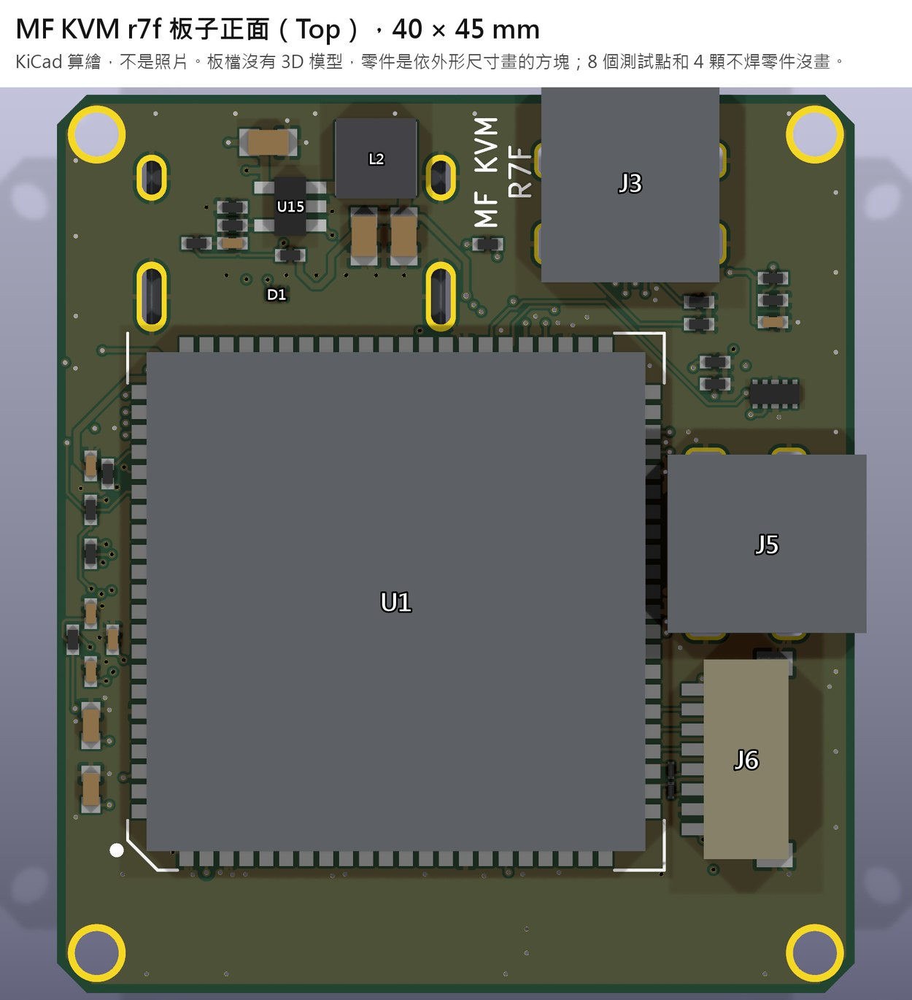
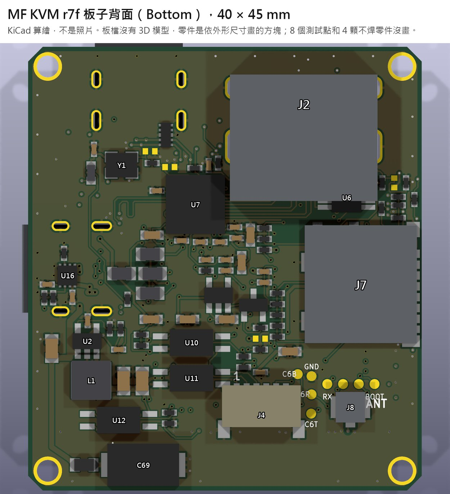
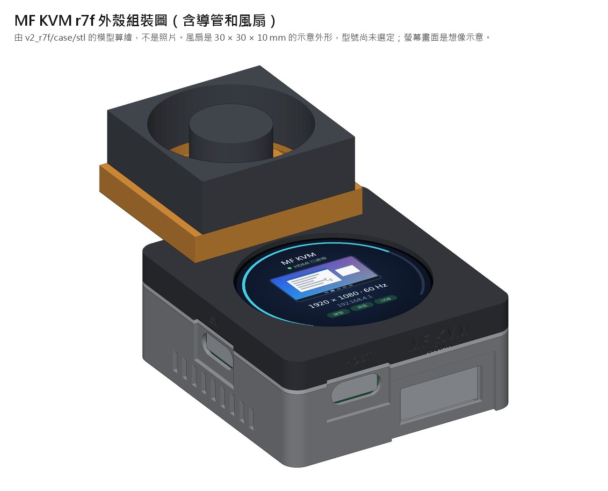
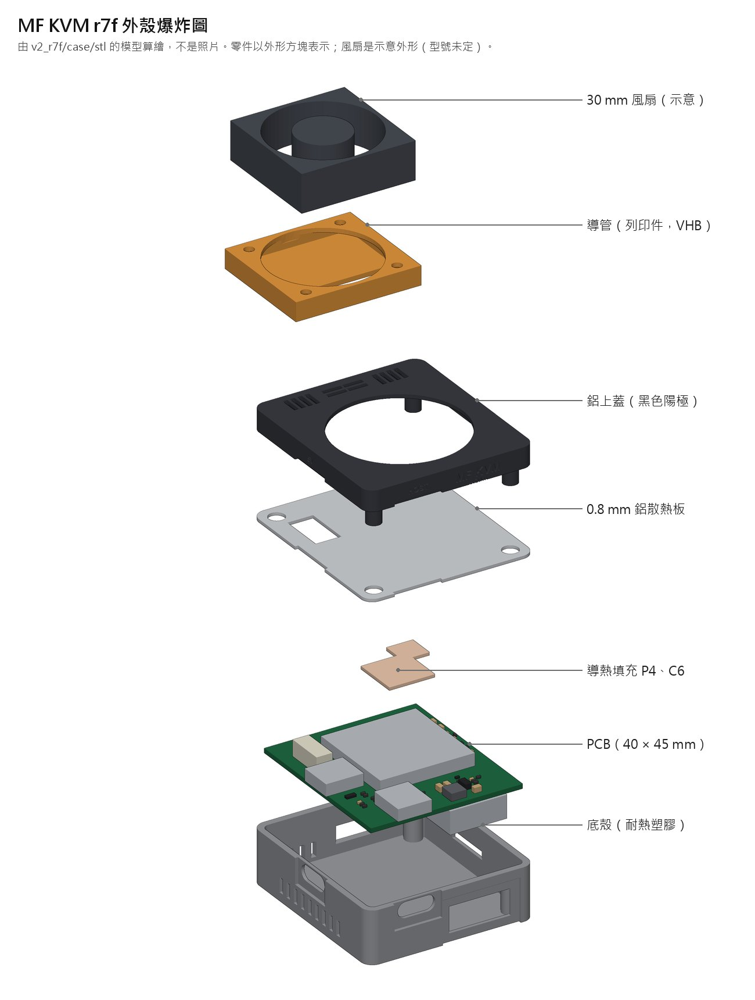

# MF KVM

**繁體中文** | [English](README.en.md)

MF KVM 是以 ESP32-P4 為主控、跑 [ESP-KVM](https://github.com/espkvm/espkvm) 韌體的 KVM over IP 小盒子：接上主機的 HDMI 和 USB 之後，就能透過 Wi-Fi 從瀏覽器看主機畫面、操作鍵盤滑鼠，也能按主機的電源和重置鍵。這個 repo 並列兩個設計：`off-the-shelf/` 用買得到的現成板組裝，只自製一片 ATX 小板；`lay-board/` 把所有電路自己布在一片 6 層板上。

**狀態：還沒有做出實品。** 目前版本 r7f 已送 JLC 審核、尚未付款。通過的都是檔案和模型層級的檢查，沒有任何一項在硬體上驗證過。

尚未選擇授權，保留所有權利。第三方內容見 [THIRD_PARTY.md](THIRD_PARTY.md)。

## 目前版本：r7f

6 層單片板，雙面放零件。主控是 ESP32-P4-Module（U1，組裝後手焊），影像用 TC358743（U7，BGA）。

| 正面 | 背面 |
|---|---|
|  |  |

| 外殼組裝 | 爆炸圖 |
|---|---|
|  |  |

以上都是電腦算繪，不是照片。板檔沒有 3D 模型，零件是依外形和高度畫的方塊，風扇是示意外形。

| 項目 | 規格 |
|---|---|
| 板子 | 40 × 45 mm，6 層，JLC06121H-3313 |
| 外殼本體 | 44 × 49 × 20 mm，鋁上蓋，底殼 ASA／ABS／PC／PA12（不用 PLA） |
| 含導管和風扇 | 44 × 69.2 × 35 mm（風扇厚度 10 mm 是假設） |
| 額定環境溫度 | 25 °C，要裝導管式風扇 |
| 主控 | ESP32-P4-Module 基本款（SKU 28101），內建 ESP32-C6，2.4 GHz Wi-Fi，U.FL 外接天線 |
| 影像 | TC358743XBG，HDMI 轉 CSI |
| 螢幕 | 1.28 吋圓形 LCD |
| 打板包 | [`lay-board/r7f/fab_r7f/`](lay-board/r7f/fab_r7f/)，Gerber zip sha256 開頭 `5edbd116` |

### 這版改了什麼（相對 r7e）

下表的數字都是模型算出來的，不是實測。

| 項目 | 改了什麼 | 結果 |
|---|---|---|
| 5 V 輸入保護 | 加 eFuse U16（TPS259531），限流約 2 A，輸出鉗位 5.7 V | 插電瞬間峰值電流 10–18 A → 4.1–5.3 A |
| HDMI CEC | CEC 線加 ESD 保護 D1（TPD1E10B06） | 原本這條線沒有保護 |
| microSD 訊號 | 6 條線各串 22 Ω（R74–R79） | 寫入過衝 0.79–1.16 V → 0.05–0.23 V |
| LCD 訊號 | DIN、CLK 串 33 Ω（R80、R81，0201） | LCD CLK 過衝 1.51 V → 0.61 V |
| 散熱 | 鋁上蓋、0.8 mm 鋁板、P4 和 C6 上的導熱膠、12 條通風槽 | 一般負載下上蓋 52.9 °C → 49.5 °C（環境 25 °C） |
| 導管式風扇 | 加 3D 列印導管和 30 mm 風扇，風扇自己接 USB 供電，PCB 不改 | 上蓋 36.2 °C、底殼 41.5 °C，低於接觸超過 1 分鐘的 48 °C（0.15 L/s，流量是假設） |
| 外殼接地 | 安裝孔鍍通接地，上蓋和鋁板的接觸面不上陽極膜 | 驗收：上蓋、鋁板對 GND 要 < 1 Ω |
| 手焊間距 | U1 旁 22 個焊盤都留 ≥ 0.2 mm 和防焊隔開，J6 外移 0.65 mm | 最小 0.387 mm |

**從 r5 走到 r7f 的主要變化：** r6 加 U.FL 和 50 Ω RF 線、阻抗改用場解算；r7 的 1.2 V 改成降壓（U15）、DDC 改 TCA9517A；r7c 板子加長到 40 × 45 mm 並加 C69；r7d 做 CSI 等長；r7e 補冷啟動分析。

### 驗證到哪裡

| 已通過（檔案和模型層級） | 結果 |
|---|---|
| ERC、DRC | 0 錯誤、0 未連線，29 個警告逐項接受 |
| 電氣規則檢查（含 eFuse） | 全部通過 |
| 故意放錯測試 | 126 次全部抓到 |
| 外殼幾何 | 99/99 |
| 阻抗、CSI 等長、參考層、防焊、孔距、零件本體 | 通過 |
| 獨立複審與差異複審 | 0 嚴重，有條件可送板 |

**沒有驗證：** 還沒有實體板，EMI、RF／RSSI、影像、USB、Wi-Fi、風扇實際風量和溫度都沒測過。完整清單在[驗證報告](lay-board/r7f/pdf/r7f_驗證報告.pdf)第 2 節。

**現在的進度：** 已送 JLC 審核，尚未付款，尚未打板。JLC 按確認前還要在預覽逐顆核對 U16 第 1 腳和 16 顆方向未定的零件（U16 轉 180° 會讓 VBUS 短路到 GND）。

**完整資料：** [r7f 說明](lay-board/r7f/README.md)、[改版報告](lay-board/r7f/R7F_REPORT.md)、[獨立複審](lay-board/r7f/REVIEW_r7f.md)、[差異複審](lay-board/r7f/DELTA_r7f.md)、[圖面與報告 PDF](lay-board/r7f/pdf/)。

## 較早的設計（ARCHIVE）

以下保留當時的內容當紀錄，都不是目前版本。`lay-board/` 這欄是 r5，那張單已經取消。

| | [`off-the-shelf/`](off-the-shelf/README.md)（現成料，第三版） | [`lay-board/`](lay-board/README.md)（客製板，第二版 r5） |
|---|---|---|
| **外殼尺寸** | 75.0 × 38.05 × 26.73 mm | 44 × 44 × 20 mm |
| **體積** | 76 cm³ | 39 cm³ |
| **買什麼** | DFRobot FireBeetle 2 ESP32-P4（DFR1172）、Geekworm C790、Waveshare 1.9 吋 LCD、Würth 50 mm 15-pin 排線（接點異面、同面各 1）、改過不接 VBUS 的 USB 線、Ø0.64 銅線、JST SH 線、螺絲、5 V 電源 | Waveshare ESP32-P4-Module-U（IPEX）、FPC 天線、1.28 吋圓形 LCD、自製 SHR-08 和 SHR-06 線、M2 × 16 螺絲 4 支 |
| **打什麼板** | 2 層 ATX 小板 rev B，11.05 × 35.4 mm（`fab_atx_b/`），尚未下單 | 6 層 40 × 40 mm 主板加雙面 PCBA，含 BGA（`fab_r5/`），JLC 審查中、未付款 |
| **印什麼** | 底殼、上蓋、C790 橋架、排線捲線棒、ATX 焊接墊片（建議 PETG） | 底殼、上蓋 |
| **韌體** | ESP-KVM `0893eef`，加 ST7789 修補與 ATX 修補（兩支 patch），只編譯過 | ESP-KVM `0893eef`，加開機預設值修補與 ATX 修補（兩支 patch），只編譯過。ATX 預設關閉，到 console 打開，見 `lay-board/firmware/BUILD_v2.md` |
| **主要風險** | 排線斜捲 45° 沒人測過、回報僅約 9 fps、ATX 小板焊死後要斜著裝 | 首版 6 層加 BGA 有錯就要重打、阻抗只有公式估算、最壞公差有 4 對本體可能相碰 |
| **狀態** | 只有設計，零件未買 | 打板包只能送 CAM 預審，還不能算放行 |
| **什麼時候選它** | 想先驗證功能、不想打 6 層板和焊 BGA、接受比較大的盒子。目前建議當驗證機，也能先驗證兩邊共用的韌體 | 要最小的外形，或要走正式小型產品，且願意承擔首版改板 |

每個設計的 README 都有 **「還缺什麼」** 清單，列出下單前和實機要做的事：[off-the-shelf](off-the-shelf/README.md#還缺什麼)、[lay-board](lay-board/README.md#還缺什麼)。

## 當時的建議順序（r5 時期）

1. 買 `off-the-shelf` 的料，先用線接起來跑通影像、USB、Wi-Fi，不用打板也不用列印。
2. 拿實測影格率決定 `off-the-shelf` 能不能接受，同時驗證 `lay-board` 也會用到的韌體路徑。
3. `lay-board` 依 CAM 回覆決定要不要修，審查通過也先不付款，全部驗證過才打板。

## 3D 頁面

這兩個連結是**擁有者私人頁面，別人打不開**。每個資料夾裡的本機 HTML 是同一份內容，下載後用瀏覽器開就能看（3D 需要連上網路載入 three.js）：

| 設計 | 私人連結 | 本機檔案 |
|---|---|---|
| lay-board | https://claude.ai/artifact/GMou6HJAjchfPkJ2fzq8we | [`lay-board/kvm-mini.html`](lay-board/kvm-mini.html) |
| off-the-shelf | https://claude.ai/artifact/LdwRVth9BPiBVDjdgMhgdb | [`off-the-shelf/v3.html`](off-the-shelf/v3.html) |

## 不在這個 repo 的東西

- **第一版（NANO 模組疊自製底板）：** 排針位置錯，已放棄，沒有放進來。
- **舊打板包：** `fab`、`fab_new`、`fab_r2`～`fab_r4`、`fab_atx` 都不能用，原因寫在各 README。
- **建置輸出：** ESP-KVM clone、build 目錄、映像檔、建置 log。重新編譯的方法在各 README。
- **第三方原始檔：** NANO 官方 CAD、ExoAnchor 壓縮檔、FireBeetle STEP。來源見 [THIRD_PARTY.md](THIRD_PARTY.md) 和 `off-the-shelf/research/`。

## 常用檢查（在 repo 根目錄）

```sh
python lay-board/tools/maskcheck.py lay-board/fab_r5/p4_kvm_mini_gerber.zip
python lay-board/tools/holecheck.py lay-board/fab_r5/p4_kvm_mini_gerber.zip
sh lay-board/tools/check.sh out/final.ses     # 要 KiCad，路徑用 KICAD_CLI、KICAD_TOOL_HOME 覆寫
python lay-board/tools/bodycheck.py lay-board/out
python lay-board/tools/maskcheck.py off-the-shelf/fab_atx_b/mf_kvm_atx_gerber.zip
python lay-board/tools/holecheck.py off-the-shelf/fab_atx_b/mf_kvm_atx_gerber.zip
```

`.gitattributes` 設定 `* -text`，檔案逐位元組保存，不轉換行尾，所以 Gerber 雜湊不會變，`.sh` 也不會變成 CRLF。
