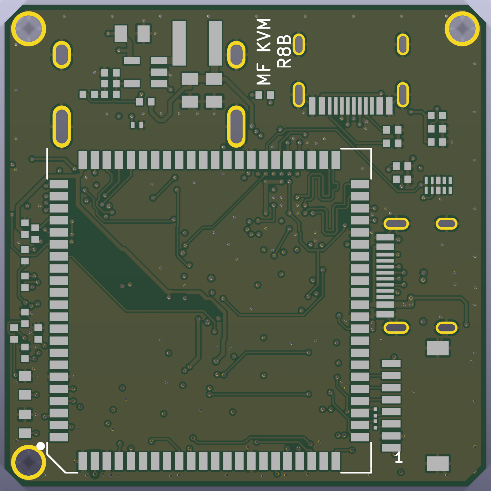
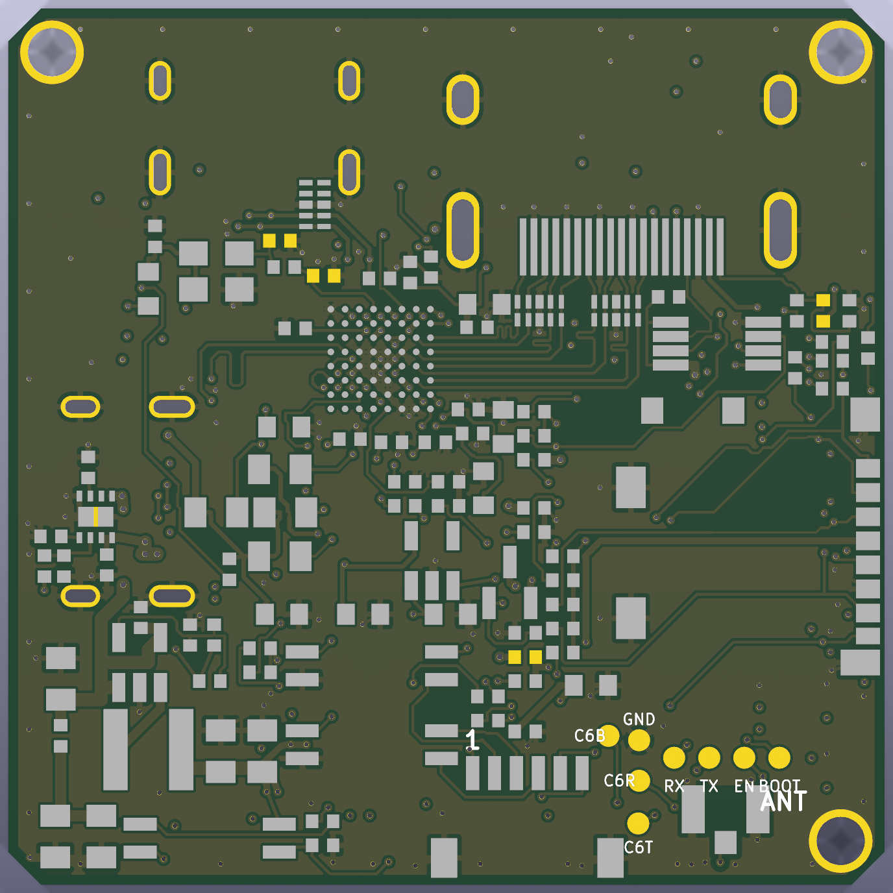
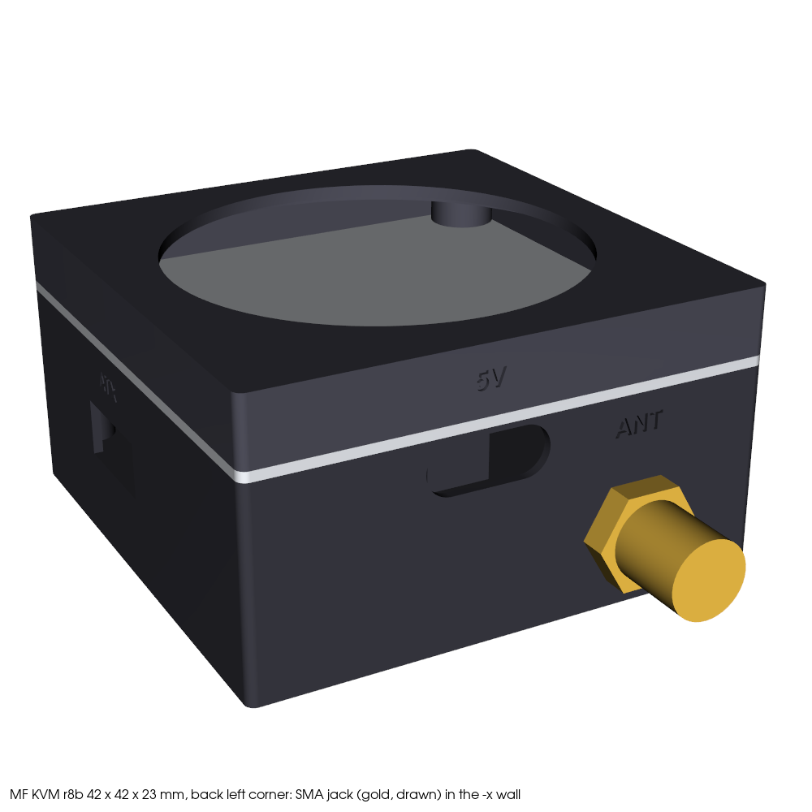
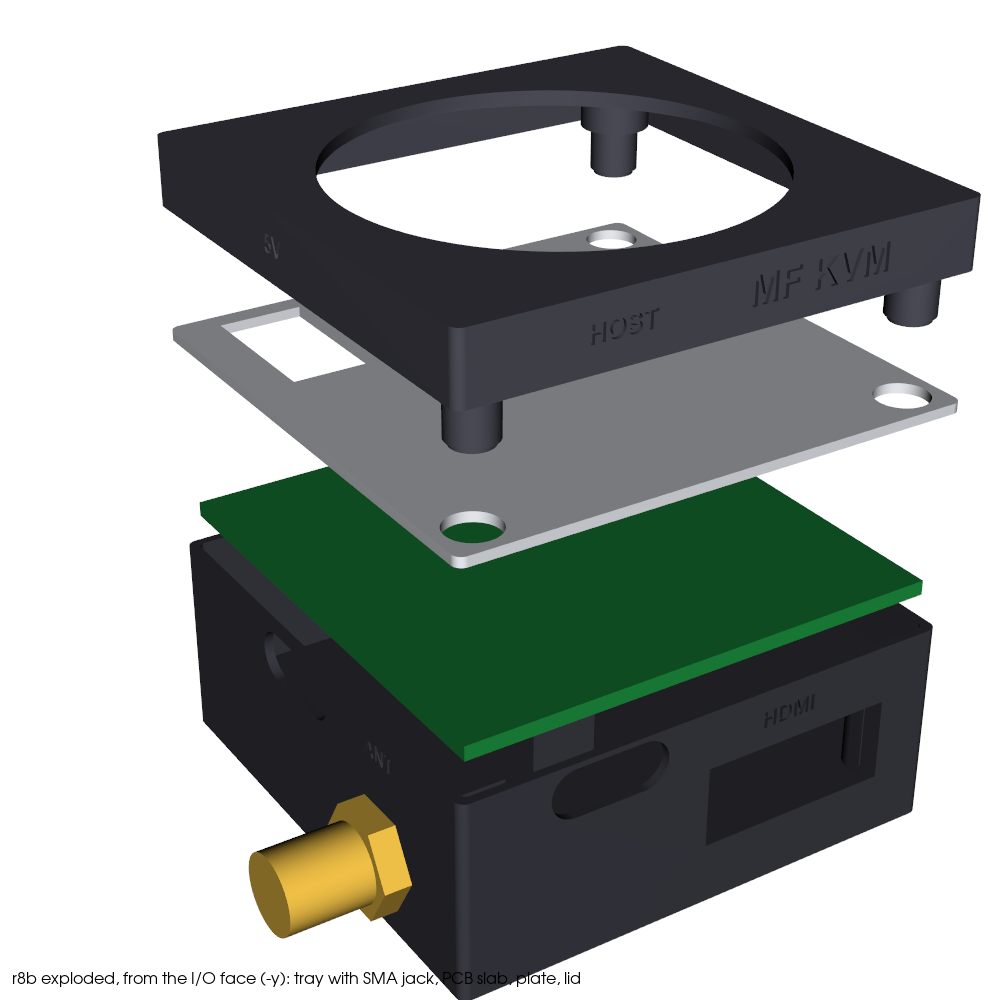

# MF KVM

**繁體中文** | [English](README.en.md)

MF KVM 是以 ESP32-P4 為主控、跑 [ESP-KVM](https://github.com/espkvm/espkvm) 韌體的 KVM over IP 小盒子：接上主機的 HDMI 和 USB 之後，就能透過 Wi-Fi 從瀏覽器看主機畫面、操作鍵盤滑鼠，也能按主機的電源和重置鍵。這個 repo 並列兩個設計：`off-the-shelf/` 用買得到的現成板組裝，只自製一片 ATX 小板；`lay-board/` 把所有電路自己布在一片 6 層板上。

**狀態：r8b 已於 2026-11-16 下單打板，板子還沒到。** 沒有焊過、沒有上電，通過的都是檔案和模型層級的檢查，沒有任何一項在硬體上驗證過。

授權見 [LICENSE](LICENSE)：硬體 CERN-OHL-P-2.0、程式 Apache-2.0、文件 CC-BY-4.0。第三方內容另依原本的條款，見 [THIRD_PARTY.md](THIRD_PARTY.md)。

## 目前版本：r8b

6 層單片板，40 × 40 mm，雙面放零件。主控是 ESP32-P4-Module（U1，組裝後手焊），影像用 TC358743（U7，BGA）。外殼是全鋁、無風扇，42 × 42 × 23 mm，Wi-Fi 天線外接。

| 正面 | 背面 |
|---|---|
|  |  |

<details>
<summary>零件代號對照表（點開看圖查詢）</summary>

**正面（Top）**

| 代號 | 是什麼 | 用途／備註 |
|---|---|---|
| U1 | ESP32-P4 模組 | 主控加 Wi-Fi，另外買、組裝後手焊，最大熱源 |
| J3 | USB-C | 接被控主機（鍵盤滑鼠、虛擬媒體） |
| J5 | USB-C | 5 V 供電、燒錄、console |
| J6 | SM08B 8P | 接圓形 LCD |
| U14 | ESD 保護 | J5 的 USB 線 |
| U15 + L2 | 降壓 | 3V3 → 1.2 V |
| D1 | ESD 保護 | HDMI CEC |

**背面（Bottom）**

| 代號 | 是什麼 | 用途／備註 |
|---|---|---|
| J2 | HDMI | 影像輸入 |
| U7 | TC358743 BGA | HDMI 轉 CSI，最燙的晶片 |
| J7 | microSD | 虛擬媒體、儲存 |
| U16 | TPS259531 eFuse | 5 V 輸入保護，下單要核對方向 |
| U2 + L1 | 降壓 | 5 V → 3V3 |
| U4 | LDO | 3V3 → 2.5 V |
| U6 | TCA9517A | HDMI DDC 準位轉換 |
| U3、U8、U9 | ESD 保護 | J3 的 USB 線、HDMI TMDS |
| U10、U11、U12 | 光耦 | ATX 電源、重置、LED |
| J4 | SM06B 6P | 接 ATX 前面板 |
| J8 | U.FL | 接 Wi-Fi 天線（用線接到外殼上的 SMA 座） |
| Y1 | 27 MHz 振盪器 | U7 的時脈 |
| Q1 | P 通道 MOSFET | microSD 電源開關 |
| R68 + C72、C73 | 0.47 Ω 加兩顆 22 µF | 5 V 阻尼，取代 r7f 的 330 µF C69 |

電阻、電容太多沒有列，完整清單見 [`BOM_JLC.csv`](lay-board/r8b/fab_r8b/BOM_JLC.csv)。

</details>

| 外殼組裝 | 爆炸圖 |
|---|---|
|  |  |

以上都是電腦算繪，不是照片。板檔沒有 3D 模型，零件是依外形和高度畫的方塊。

| 項目 | 規格 |
|---|---|
| 板子 | 40 × 40 mm，6 層，1.2 mm，JLC06121H-3313，三顆安裝孔 |
| 外殼 | 42 × 42 × 23 mm，6061 鋁 CNC、黑色陽極，無風扇 |
| 表面溫度（模型） | 室溫 25 °C、一般負載下最高約 51.5 °C |
| 主控 | ESP32-P4-Module 基本款（SKU 28101，16MB、天線從焊盤引出），內建 ESP32-C6，2.4 GHz Wi-Fi |
| 天線 | 板上 U.FL，轉 SMA 到外殼左牆，外接天線 |
| 影像 | TC358743XBG，HDMI 轉 CSI |
| 螢幕 | 1.28 吋圓形 LCD（選配） |
| 供電 | Type-C，要能供 1.5 A 以上 |
| 打板包 | [`lay-board/r8b/fab_r8b/`](lay-board/r8b/fab_r8b/)，Gerber zip sha256 開頭 `3613530e` |

### 這版改了什麼（相對 r7f）

| 項目 | 改了什麼 |
|---|---|
| 板子尺寸 | 40 × 45 → 40 × 40 mm，安裝孔 4 顆 → 3 顆 |
| 5 V 阻尼 | 拿掉 330 µF 的 C69，R68 改成 0.47 Ω，新增 C72、C73（22 µF 0805） |
| 外殼 | 由「鋁上蓋＋塑膠底殼＋外接風扇導管」改成全鋁、無風扇，42 × 42 × 23 mm |
| 天線（r8b） | 改外接：外殼左牆開 SMA 孔，U.FL 轉 SMA 線接板子背面的 J8 |
| 板邊淨空（r8b） | SD_CMD 的兩顆過孔和 ATX_LED 走線往板內移到離板邊 0.40 mm 以上 |
| 高度夾持（r8b） | 上蓋的柱子不再壓板子，改用泡棉墊圈 |

TMDS、CSI、USB 的走線和 r7f 相同；r8 → r8b 零件位置、BOM、CPL 都沒有變，108 個網路只有 4 個的銅不同。

**板廠生產時改了阻抗線的線寬：** 100 Ω 線 5.0/7.8 → 4.7/8.1 mil，USB 90 Ω 線寬 7.09 → 6.37 mil，中心距和疊構不變。所以實體板的這幾條線和 repo 裡的 Gerber 不同。用本專案的解算器代回去，都還在 ±10 % 內，見 [`IMPEDANCE_AS_BUILT.md`](lay-board/r8b/IMPEDANCE_AS_BUILT.md)。

### 驗證到哪裡

| 已通過（檔案和模型層級） | 結果 |
|---|---|
| ERC、DRC | ERC 通過；DRC 0 錯誤、0 未連線，29 個警告逐項接受 |
| 電氣規則、熱插拔、輸入濾波、參考層、差動對間距、CSI 過孔、手焊間距、阻抗、零件本體 | 全部通過 |
| 板子故意放錯測試 | 124 項全部抓到 |
| 外殼幾何 | 124 項通過；故意放錯 22 項全部抓到 |
| 獨立複審（r8） | 板子有條件可送；外殼的 1 項嚴重、3 項主要問題在 r8b 處理或由使用者裁決結案。r8b 沒有再做一次獨立複審 |

**沒有驗證：** 還沒有實體板，EMI、RF／RSSI、影像、USB、Wi-Fi、溫度都沒測過。熱模型在 r8b 沒有重跑。韌體只編譯過，沒有燒過。天線線、天線、泡棉墊圈、導熱材料都還沒選定料號。

**現在的進度：** 2026-11-16 下單，等板子。到貨後照 [`BRINGUP_CHECKLIST.md`](lay-board/r8b/BRINGUP_CHECKLIST.md) 上電。

**完整資料：** [r8b 說明](lay-board/r8b/README.md)、[R8B 改版報告](lay-board/r8b/R8B_REPORT.md)、[R8 改版報告](lay-board/r8b/R8_REPORT.md)、[獨立複審](lay-board/r8b/REVIEW_r8.md)、[熱分析](lay-board/r8b/thermal/THERMAL_R8.md)。上一版 r7f 的資料留在 [`lay-board/r7f/`](lay-board/r7f/README.md)。

## 較早的設計（ARCHIVE）

以下保留當時的內容當紀錄，都不是目前版本。`lay-board/` 這欄是 r5，那張單已經取消。

| | [`off-the-shelf/`](off-the-shelf/README.md)（現成料，第三版） | [`lay-board/`](lay-board/README.md)（客製板，第二版 r5） |
|---|---|---|
| **外殼尺寸** | 75.0 × 38.05 × 26.73 mm | 44 × 44 × 20 mm |
| **體積** | 76 cm³ | 39 cm³ |
| **買什麼** | DFRobot FireBeetle 2 ESP32-P4（DFR1172）、Geekworm C790、Waveshare 1.9 吋 LCD、Würth 50 mm 15-pin 排線（接點異面、同面各 1）、改過不接 VBUS 的 USB 線、Ø0.64 銅線、JST SH 線、螺絲、5 V 電源 | Waveshare ESP32-P4-Module-U（IPEX）、FPC 天線、1.28 吋圓形 LCD、自製 SHR-08 和 SHR-06 線、M2 × 16 螺絲 4 支 |
| **打什麼板** | 2 層 ATX 小板 rev B，11.05 × 35.4 mm（`fab_atx_b/`），尚未下單 | 6 層 40 × 40 mm 主板加雙面 PCBA，含 BGA（`fab_r5/`），JLC 審查中、未付款 |
| **印什麼** | 底殼、上蓋、C790 橋架、排線捲線棒、ATX 焊接墊片（建議 PETG） | 底殼、上蓋 |
| **韌體** | ESP-KVM `0893eef`，加 ST7789 修補與 ATX 修補（兩支 patch），只編譯過 | ESP-KVM `0893eef`，加開機預設值修補與 ATX 修補（兩支 patch），只編譯過。ATX 預設關閉，到 console 打開，見 `lay-board/firmware/BUILD_v2.md` |
| **主要風險** | 排線斜捲 45° 沒人測過、回報僅約 9 fps、ATX 小板焊死後要斜著裝 | 首版 6 層加 BGA 有錯就要重打、阻抗只有公式估算、最壞公差有 4 對本體可能相碰 |
| **狀態** | 只有設計，零件未買 | 打板包只能送 CAM 預審，還不能算放行 |
| **什麼時候選它** | 想先驗證功能、不想打 6 層板和焊 BGA、接受比較大的盒子。目前建議當驗證機，也能先驗證兩邊共用的韌體 | 要最小的外形，或要走正式小型產品，且願意承擔首版改板 |

每個設計的 README 都有 **「還缺什麼」** 清單，列出下單前和實機要做的事：[off-the-shelf](off-the-shelf/README.md#還缺什麼)、[lay-board](lay-board/README.md#還缺什麼)。

## 當時的建議順序（r5 時期）

1. 買 `off-the-shelf` 的料，先用線接起來跑通影像、USB、Wi-Fi，不用打板也不用列印。
2. 拿實測影格率決定 `off-the-shelf` 能不能接受，同時驗證 `lay-board` 也會用到的韌體路徑。
3. `lay-board` 依 CAM 回覆決定要不要修，審查通過也先不付款，全部驗證過才打板。

## 3D 頁面

這兩個連結是**擁有者私人頁面，別人打不開**。每個資料夾裡的本機 HTML 是同一份內容，下載後用瀏覽器開就能看（3D 需要連上網路載入 three.js）：

| 設計 | 私人連結 | 本機檔案 |
|---|---|---|
| lay-board | https://claude.ai/artifact/GMou6HJAjchfPkJ2fzq8we | [`lay-board/kvm-mini.html`](lay-board/kvm-mini.html) |
| off-the-shelf | https://claude.ai/artifact/LdwRVth9BPiBVDjdgMhgdb | [`off-the-shelf/v3.html`](off-the-shelf/v3.html) |

## 不在這個 repo 的東西

- **第一版（NANO 模組疊自製底板）：** 排針位置錯，已放棄，沒有放進來。
- **舊打板包：** `fab`、`fab_new`、`fab_r2`～`fab_r4`、`fab_atx` 都不能用，原因寫在各 README。
- **建置輸出：** ESP-KVM clone、build 目錄、映像檔、建置 log。重新編譯的方法在各 README。
- **第三方原始檔：** NANO 官方 CAD、ExoAnchor 壓縮檔、FireBeetle STEP。來源見 [THIRD_PARTY.md](THIRD_PARTY.md) 和 `off-the-shelf/research/`。

## 常用檢查（在 repo 根目錄）

```sh
python lay-board/tools/maskcheck.py lay-board/fab_r5/p4_kvm_mini_gerber.zip
python lay-board/tools/holecheck.py lay-board/fab_r5/p4_kvm_mini_gerber.zip
sh lay-board/tools/check.sh out/final.ses     # 要 KiCad，路徑用 KICAD_CLI、KICAD_TOOL_HOME 覆寫
python lay-board/tools/bodycheck.py lay-board/out
python lay-board/tools/maskcheck.py off-the-shelf/fab_atx_b/mf_kvm_atx_gerber.zip
python lay-board/tools/holecheck.py off-the-shelf/fab_atx_b/mf_kvm_atx_gerber.zip
```

`.gitattributes` 設定 `* -text`，檔案逐位元組保存，不轉換行尾，所以 Gerber 雜湊不會變，`.sh` 也不會變成 CRLF。
