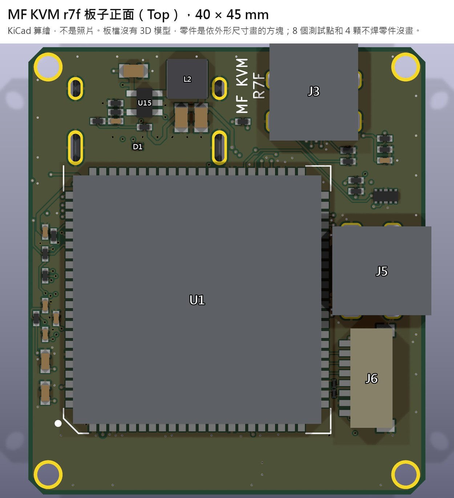
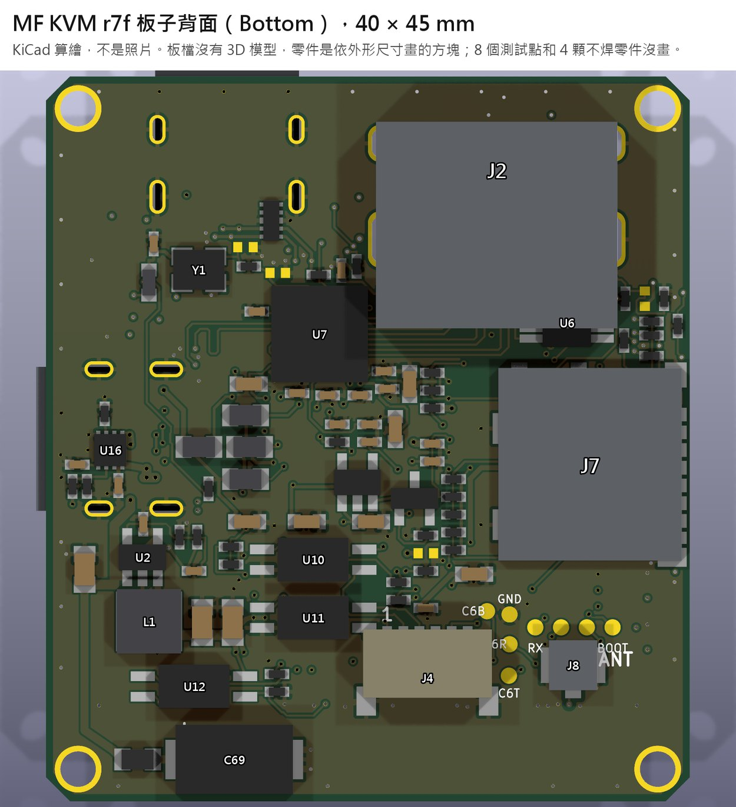
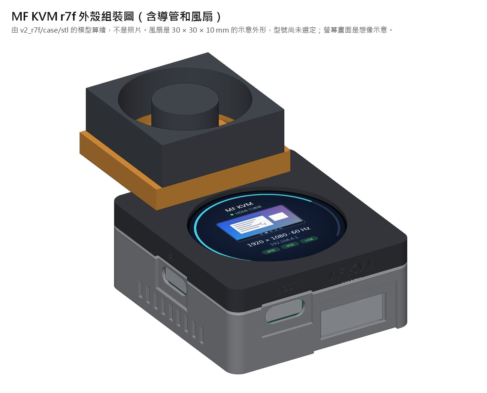
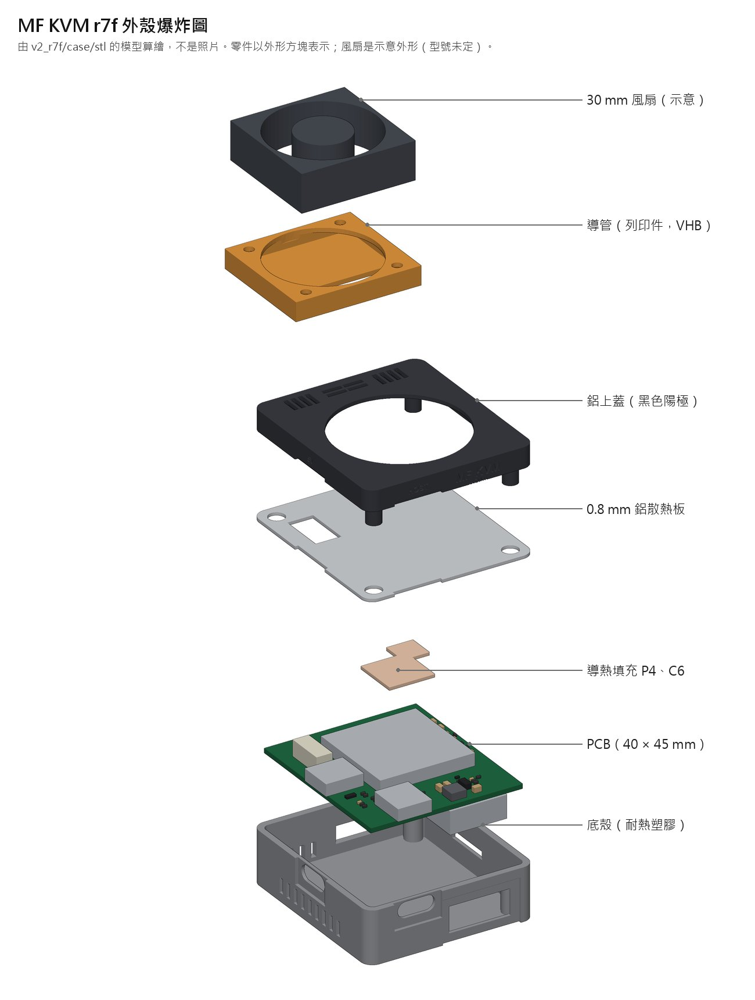
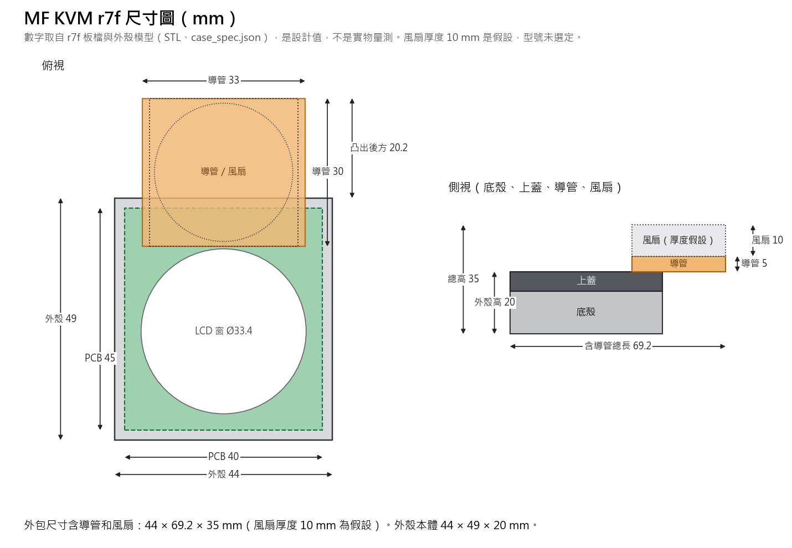

# MF KVM lay-board r7f

目前的板子版本。6 層 40 × 45 mm，ESP32-P4-Module（U1，手焊）加 TC358743（U7，BGA）。

**狀態：已送 JLC 審核，尚未付款、尚未打板。** 通過的都是檔案和模型層級的檢查，沒有任何一項在實機驗證過。沒有驗證的項目列在 `pdf/r7f_驗證報告.pdf` 第 2 節。

| 項目 | 值 |
|---|---|
| Gerber zip sha256 | `5edbd11614de56c81819c0f49b667f6346e41d8fef006e6f3f2256d9243e99f7` |
| PDF build | 20261109-1615（佈局圖重新輸出為 20261109-1657） |
| 驗證 | 所有閘門通過；故意放錯測試 126 次全部抓到；外殼檢查 99/99 |
| 額定環境溫度 | 25 °C，需要導風罩加風扇（見 `case/00_外殼說明.txt`） |

每次重跑 release，zip 的 sha 都會變（零件 ID 隨機、檔案寫入時間），設計沒有改也一樣。判斷兩包是否相同要比對幾何，不能比 sha。

## 圖

**下面都是電腦算繪，不是照片。** 板子還沒有做出來。

板檔裡沒有任何 3D 模型，所以板子圖上的 125 顆零件都是依外形尺寸和高度畫的方塊，顏色只用來分類，不代表實物。8 個測試點和 4 顆不焊的零件（C30、C31、R31、R41）沒有畫。風扇型號還沒選，圖上的風扇是 30 × 30 × 10 mm 的示意外形。

| 正面 | 背面 |
|---|---|
|  |  |

零件代號對照表（點開看圖查詢）

**正面（Top）**

| 代號 | 是什麼 | 用途／備註 |
|---|---|---|
| U1 | ESP32-P4 模組 | 主控加 Wi-Fi，客供、組裝後手焊，最大熱源 |
| J3 | USB-C | 接被控主機（鍵盤滑鼠、虛擬媒體） |
| J5 | USB-C | 5 V 供電、燒錄、console |
| J6 | SM08B 8P | 接圓形 LCD |
| U14 | ESD 保護 | J5 的 USB 線 |
| U15 + L2 | 降壓 | 3V3 → 1.2 V |
| D1 | ESD 保護 | HDMI CEC |

**背面（Bottom）**

| 代號 | 是什麼 | 用途／備註 |
|---|---|---|
| J2 | HDMI | 影像輸入 |
| U7 | TC358743 BGA | HDMI 轉 CSI，最燙的晶片 |
| J7 | microSD | 虛擬媒體、儲存 |
| U16 | TPS259531 eFuse | 5 V 輸入保護，下單要核對方向 |
| U2 + L1 | 降壓 | 5 V → 3V3 |
| U4 | LDO | 3V3 → 2.5 V |
| U6 | TCA9517A | HDMI DDC 準位轉換 |
| U3、U8、U9 | ESD 保護 | J3 的 USB 線、HDMI TMDS |
| U10、U11、U12 | 光耦 | ATX 電源、重置、LED |
| J4 | SM06B 6P | 接 ATX 前面板 |
| J8 | U.FL | 接 Wi-Fi 天線 |
| Y1 | 27 MHz 振盪器 | U7 的時脈 |
| Q1 | P 通道 MOSFET | microSD 電源開關 |
| C69 | 330 µF POSCAP | 5 V 大電容 |

電阻、電容太多沒有列，完整清單見 [`BOM_JLC.csv`](fab_r7f/BOM_JLC.csv)。

| 組裝 | 爆炸 |
|---|---|
|  |  |

| 尺寸（mm，設計值） | 長 × 寬 × 高 |
|---|---|
| 板子 | 40 × 45 |
| 外殼本體 | 44 × 49 × 20 |
| 含導管和風扇的外包 | 44 × 69.2 × 35（風扇厚度 10 mm 為假設） |

## 內容

| 路徑 | 說明 |
|---|---|
| `R7F_REPORT.md` | 改版報告，先看這份 |
| `REVIEW_r7f.md`、`DELTA_r7f.md` | 獨立複審與差異複審 |
| `PROGRESS.md`、`MUTATION_REPORT.txt`、`VERIFY_AUDIT.md` | 過程紀錄、故意放錯測試結果、檢查工具稽核 |
| `pdf/` | 圖面、報告、48 頁驗證報告。說明見 `pdf/00_說明.txt` |
| `fab_r7f/` | 打板包：Gerber、BOM、CPL、各項檢查輸出 |
| `kicad/` | KiCad 原始檔 |
| `case/` | 外殼產生與檢查程式、STL／STEP，含風扇導風罩 |
| `firmware/` | 韌體建置說明與修補 |
| `gen_mini.py`、`tools/`、`data/`、`out/` | 產生板子和跑檢查的程式、布線資料 |

`fab_r7f/README.md` 是沿用舊版的文字，內容停在 r7b，請以本頁和 `R7F_REPORT.md` 為準。

規格書版權屬原廠，沒有放在這裡。要重跑工具，用環境變數指定路徑：`KICAD_CLI`（預設 `kicad-cli`）、`KICAD_TOOL_HOME`、`FREEROUTING_JAR`、`CASE_PY`、`MFKVM_SI_SCRIPTS`（SI 分析程式，不在這個 repo）。這些工具是從原本的工作目錄複製過來的，路徑改成環境變數後只做過語法檢查，沒有在這裡完整跑過。

## 下單時必做

- JLC 預覽核對 U16（eFuse）第 1 腳：底視圖左下角，靠 C71／R71／R72。轉 180° 會讓 VBUS 短路到 GND。
- 另外 16 顆方向標為 UNKNOWN 的零件要逐顆看，對照 `pdf/r7f_CPL第1腳檢查表.pdf`。
- 風扇另外買：30 mm，規格書要有風量對風壓曲線，靜壓 ≥ 50 Pa，自己的 USB 供電。
