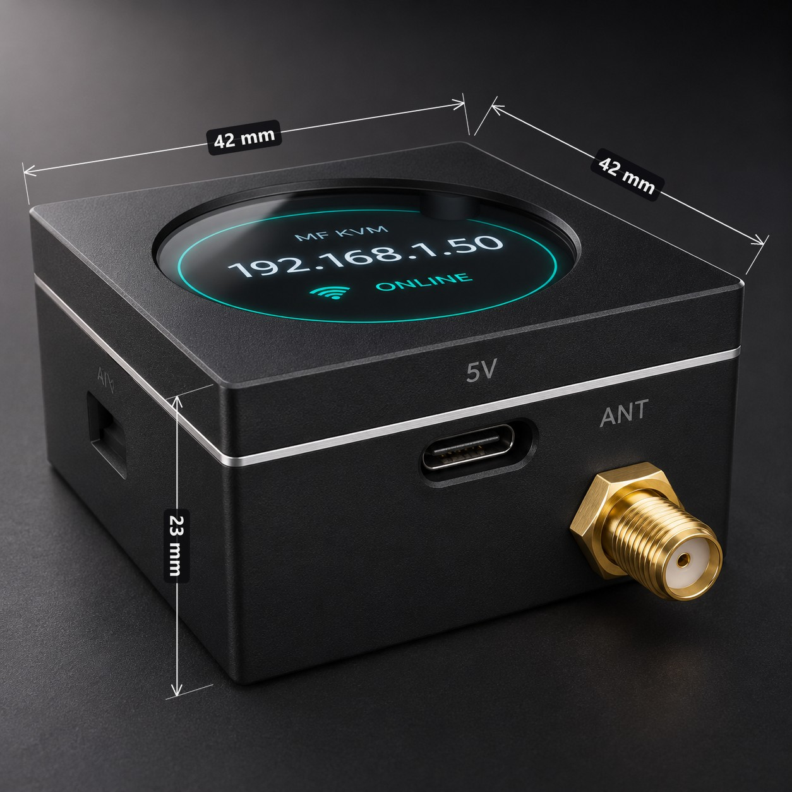
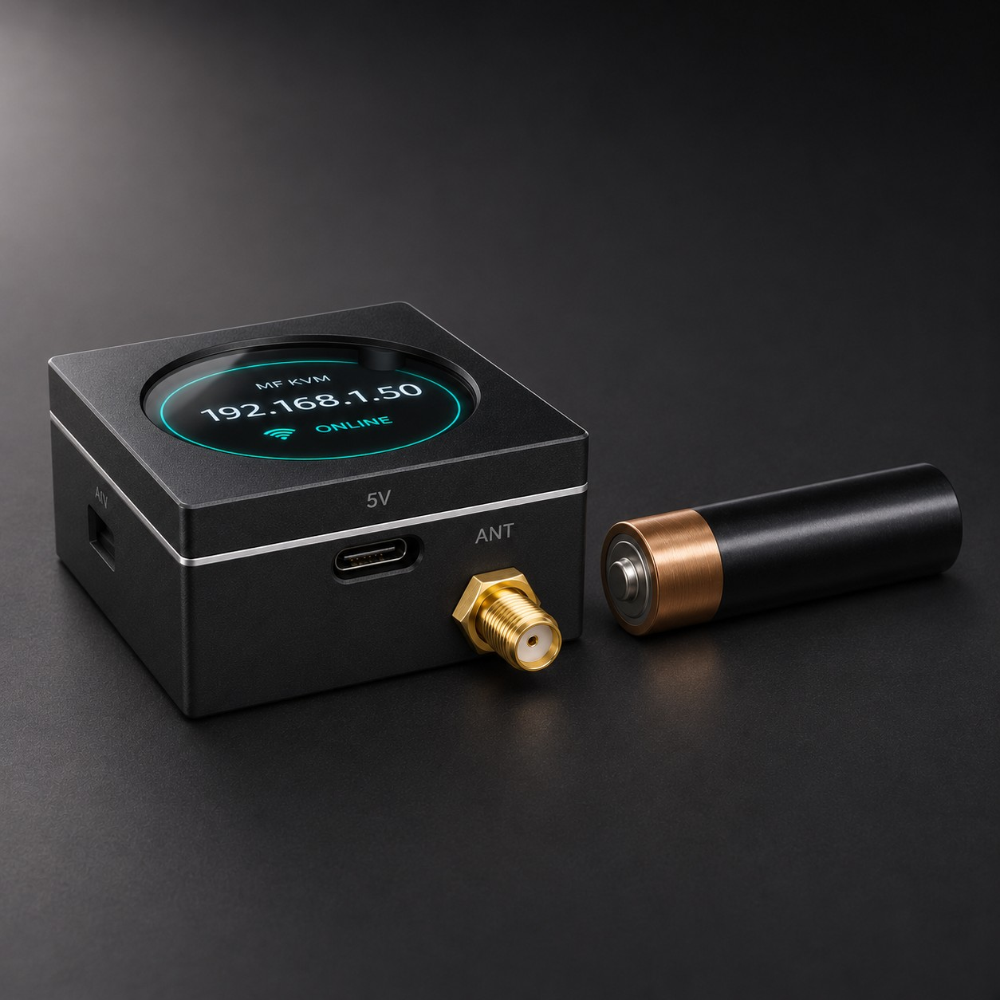
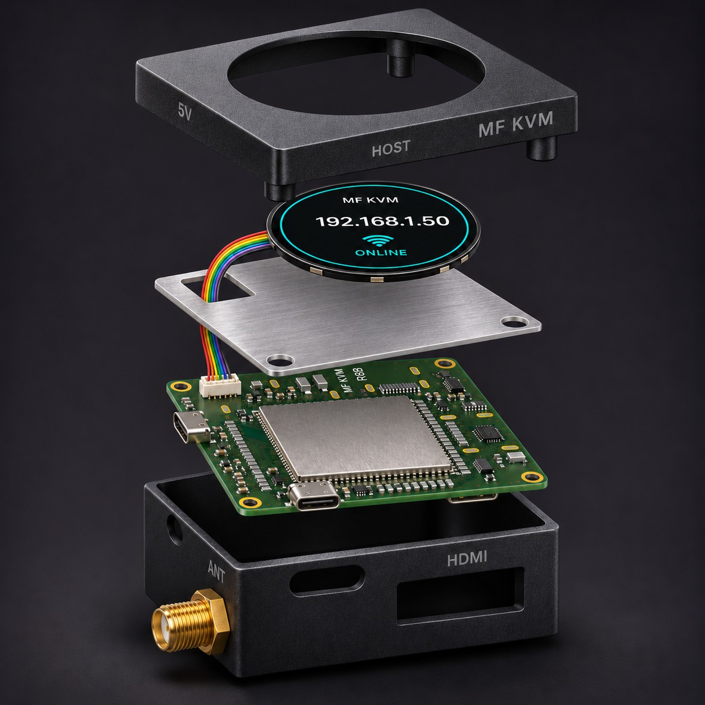
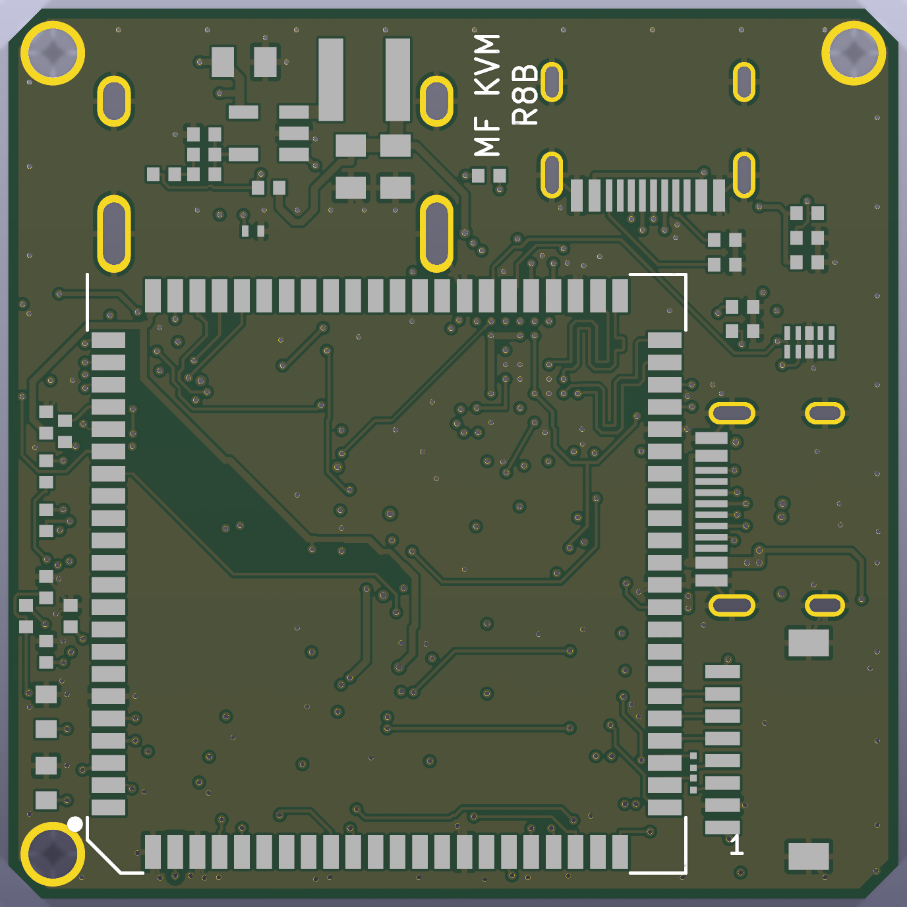
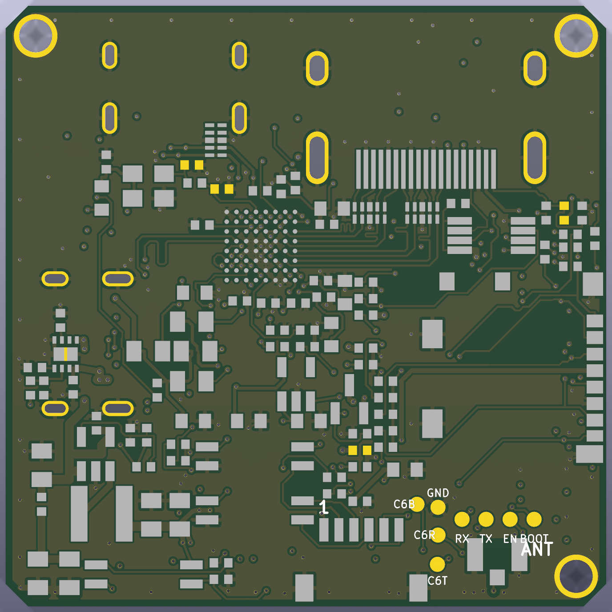
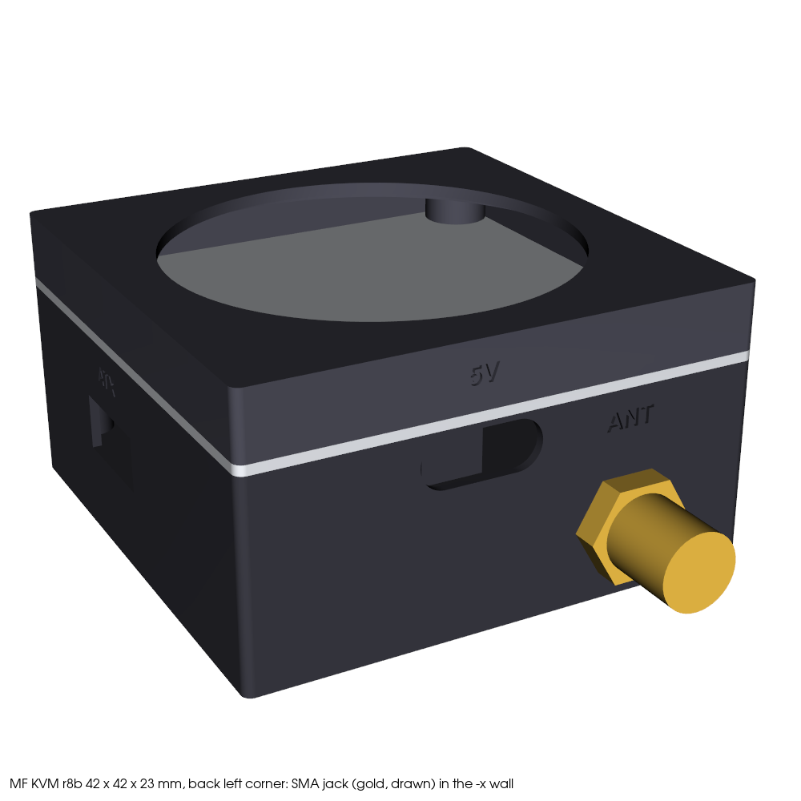
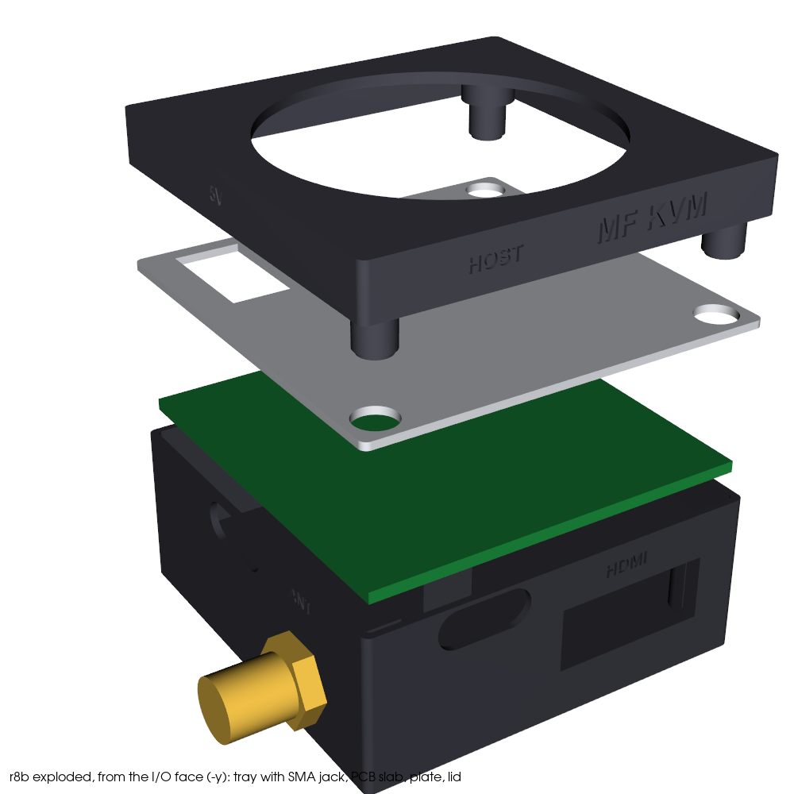
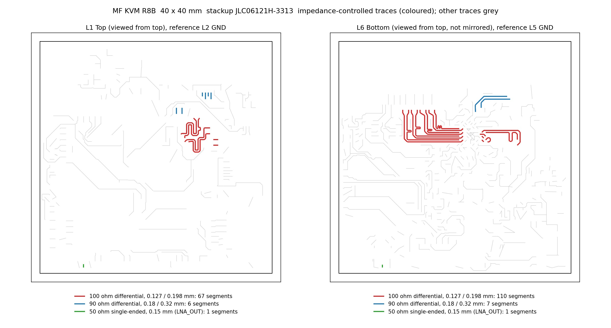

# MF KVM lay-board r8b

目前的板子版本。6 層 40 × 40 mm，ESP32-P4-Module（U1，手焊）加 TC358743（U7，BGA）。r8 由 r7f 改版，把板子從 40 × 45 縮到 40 × 40 mm，外殼改成全鋁、無風扇、42 × 42 × 23 mm；r8b 再把三處走線往板內移、天線改外接。

**狀態：2026-11-16 已下單打板，板子還沒到。** 沒有焊過、沒有上電，通過的都是檔案和模型層級的檢查，沒有任何一項在實機驗證過。

**實體板有一處和這裡的 Gerber 不同：** 板廠審核時把阻抗線改細、中心距不變（100 Ω 線 5.0/7.8 → 4.7/8.1 mil，USB 90 Ω 線寬 7.09 → 6.37 mil）。數字和核對結果在 [`IMPEDANCE_AS_BUILT.md`](IMPEDANCE_AS_BUILT.md)。

| 項目 | 值 |
|---|---|
| Gerber zip sha256 | `3613530e5c3256c378794c367a53c94c30cd249da4c4403c4d094f22236d9397` |
| 外形 | 40.0 × 40.0 mm，四角 1.5 mm 倒角，三顆 2.2 mm 鍍通安裝孔 |
| 層數、厚度 | 6 層，1.2 mm，外層 1 oz |
| 疊構 | JLC06121H-3313，阻抗控制 |
| 最小線寬線距 | 0.09 mm |
| 過孔 | 0.4 / 0.2 mm，Epoxy Filled & Capped |
| 絲印版本 | R8B |
| 供電 | Type-C，要能供 1.5 A 以上 |

每次重跑 release，zip 的 sha 都會變，設計沒有改也一樣。判斷兩包是否相同要用 `tools/gerber_equal.py` 比幾何。

## 圖

### 示意圖（AI 生成）

| 外殼和尺寸 | 和 AA 電池比大小 |
|---|---|
|  |  |

**這三張是 AI 生成的示意圖，不是照片，也不是從 CAD 直接算繪的。** 做法是拿下面的工程算繪當底圖，請生圖模型重畫成棚拍質感；尺寸標註是另外用程式畫上去的。對照過的項目：外形比例、上蓋和底殼之間的銀色分隔線、SMA 座和 USB-C 開孔的位置、各面的標籤、爆炸圖的疊放順序、螢幕的線穿過散熱板方孔接到 J6、兩個 USB-C 座分在左邊和前緣。不準的地方：螢幕畫面是示意（不是實際韌體畫面，位址是範例）、板子上模組周圍的小零件不是逐顆對應、材質和光影是想像的。要看準確的幾何用下面的工程算繪、`case/stl/` 和 Gerber。

### 工程算繪

**下面都是電腦算繪，不是照片。** 板子還沒有做出來。零件是依外形尺寸和高度畫的方塊，顏色只用來分類。

| 正面 | 背面 |
|---|---|
|  |  |

| 外殼組裝 | 外殼爆炸 |
|---|---|
|  |  |

阻抗控制走線的位置：

## 和 r7f 的差別

- 板子 40 × 45 → 40 × 40 mm。安裝孔 4 顆 → 3 顆。
- 5 V 阻尼：330 µF 的 C69 拿掉，R68 改成 0.47 Ω，新增 C72、C73（22 µF 0805）。
- 外殼由「鋁上蓋＋塑膠底殼＋外接風扇導管」改成全鋁、無風扇。
- r8b：SD_CMD 的兩顆過孔和 ATX_LED 走線往板內移到離板邊 0.40 mm 以上；天線改外接，外殼左牆開 SMA 孔；上蓋的柱子不再壓板子，改用泡棉墊圈。
- TMDS、CSI、USB 的走線和 r7f 相同。

細節看 `R8_REPORT.md` 和 `R8B_REPORT.md`。

## U1：主控模組（不在打板的 BOM 裡，要另外買、自己手焊）

| 項目 | 值 |
|---|---|
| 廠牌、型號 | Waveshare（微雪）ESP32-P4-Module |
| SKU | 28101 |
| Flash 版本 | **16MB** |
| 天線版本 | **焊盤引出版**（英文站叫 Onboard IPEX connector = Without） |
| 模組內容 | ESP32-P4NRW32X（內含 32 MB PSRAM）加 ESP32-C6（2.4 GHz Wi-Fi、藍牙） |
| 尺寸、接腳 | 25 × 25 mm，城堡焊盤，腳距 1 mm，88 腳 |

同一個商品頁還有三個版本，都不要選：

| 版本 | 為什麼不要 |
|---|---|
| IPEX 接口版（ESP32-P4-Module-U） | 天線訊號改走模組上的 IPEX 座，不從焊盤出來，板子背面的 J8 會沒有訊號 |
| 32MB | 韌體是照 16 MB 編的，燒到 32 MB 模組沒有測過 |
| 32MB 加 IPEX | 上面兩個問題都有 |

板子把模組第 2 腳（LNA_OUT）用 50 Ω 走線拉到背面的 J8（U.FL 座），再用線接到外殼上的 SMA 天線。焊盤引出版的 RF 訊號經模組上的 **R99（0 Ω）** 送到第 2 腳，R99 不能拆。模組本身沒有天線，而 Wi-Fi 是這台唯一的網路。

### 板子用到的模組腳位

| 功能 | 模組腳位 → 網路名 |
|---|---|
| 電源 | 84、85、86 → 3V3；1、3、15、33、40、47、52、83 → GND；87 → ESP_EN |
| 天線 | 2 → LNA_OUT（到 J8） |
| HDMI 擷取（MIPI CSI，來自 TC358743） | 41／42 → CSI_D0_N／P；43／44 → CSI_CK_P／N；45／46 → CSI_D1_N／P |
| TC358743 控制 | 22 → I2C_SDA；23 → I2C_SCL；32 → TC_RST（GPIO 23） |
| USB 到被控主機（J3） | 48 → USB_DN；49 → USB_DP |
| USB 燒錄和 log（J5） | 50 → USB2_DN；51 → USB2_DP（GPIO 24／25） |
| microSD（J7） | 67–70 → SD_D0–D3；71 → SD_CLK；72 → SD_CMD；73 → SD_PWR_N（GPIO 45）；66 → LDO_VO4 |
| 圓形 LCD（J6） | 24 → LCD_DIN；25 → LCD_CLK；26 → LCD_CS；27 → LCD_DC；28 → LCD_RST（GPIO 9–13） |
| ATX（J4） | 19 → ATX_PWR（GPIO 4）；20 → ATX_RST（GPIO 5）；17 → ATX_LED（GPIO 2） |
| 其他 | 18 → HOST_VBUS_DIV；62 → BOOT（TP1）；64／65 → U0_TX／U0_RX（TP3／TP4）；4／5／9／10 → C6_RXD／TXD／IO9／IO8（測試點） |

### 手焊注意

- **第 24、25 腳不要拖焊**：旁邊緊貼 R80、R81（0201，33 Ω，焊盤間距 0.387 mm）。烙鐵不要往 J6 方向帶，錫從模組那一側收。
- **第 67–72 腳不要往板子左側拖**：R79 離第 70 腳約 1 mm。
- 焊完用放大鏡看 R80、R81 還在、沒有連錫或立碑。

## 板子以外還要準備的

| 項目 | 規格 | 備註 |
|---|---|---|
| U1 模組 | 見上一節 | 每片板一顆 |
| U.FL 轉 SMA 穿牆線 | U.FL（IPEX MHF1）對標準 SMA 母座，長約 50–100 mm | 外殼照六角 8 mm、孔 6.5 mm、壓接套管 Ø5 × 10 mm 設計。料號沒有選定 |
| 2.4 GHz 天線 | 標準 SMA 公頭，底座直徑不超過 10 mm | 不是 RP-SMA。料號沒有選定 |
| Type-C 電源 | 5 V，1.5 A 以上 | 1.0 A 以下的埠在全負載下起不來（`fab_r8b/coldstart_r8.txt`） |
| USB 轉 UART 線 | 3.3 V，115200 | 開機階段的 log 只從 UART0 測試點出來 |
| 圓形 LCD（選配） | GC9A01，240 × 240，接 J6 | 不接也能開機 |
| ATX 線（選配） | JST SH 1.0 mm 6 pin，接 J4 | 韌體預設關閉 ATX，量測過才接主機板 |
| 外殼 | 6061 鋁 CNC，圖檔在 `case/stl/` | 接觸面不陽極，清單在 `case/stl/case_spec.json` 的 `masked` |
| 螺絲、泡棉墊圈 | M2 × 16 三顆；墊圈外徑 3.6、內徑 2.2、厚 1.5 mm 三片 | 墊圈料號沒有選定 |
| 導熱材料 | 模組屏蔽罩上方的填充；TC358743 下方凸台的導熱墊（間隙約 0.5 mm） | 料號沒有選定 |

第一次上電的步驟在 [`BRINGUP_CHECKLIST.md`](BRINGUP_CHECKLIST.md)。它是照文件排的，還沒有在實機上走過。

## 內容

| 路徑 | 說明 |
|---|---|
| `R8_REPORT.md`、`R8B_REPORT.md` | 改版報告，先看 R8B |
| `REVIEW_r8.md` | 獨立複審 |
| `MUTATION_REPORT.txt` | 故意放錯測試結果 |
| `IMPEDANCE_AS_BUILT.md` | 阻抗線的設計值和板廠生產值 |
| `BRINGUP_CHECKLIST.md` | 到貨當天的檢查表 |
| `fab_r8b/` | 打板包：Gerber、BOM、CPL、佈局圖和線路圖 PDF、阻抗表、各項檢查輸出 |
| `kicad/` | KiCad 原始檔 |
| `case/` | 外殼產生與檢查程式、STL／STEP、算繪圖 |
| `firmware/` | 韌體建置說明與修補。不放編好的映像 |
| `thermal/` | 熱分析報告 |
| `report_r8/` | r7f→r8、r8→r8b 的差異比對，冷啟動圖 |
| `gen_mini.py`、`layout.py`、`tools/`、`data/` | 產生板子和跑檢查的程式、布線資料 |

`fab_r8b/README.md` 是打板時的說明，內容停在下單之前，請以本頁為準。

和 `r7f/` 比，這裡沒有 `pdf/` 那一套整理過的報告，也沒有 `out/` 的中間檔。

規格書版權屬原廠，沒有放在這裡。要重跑工具，用環境變數指定路徑：`KICAD_CLI`（預設 `kicad-cli`）、`KICAD_TOOL_HOME`、`FREEROUTING_JAR`、`CASE_PY`、`CHROME`。這些工具是從原本的工作目錄複製過來的，路徑改成環境變數後只做過語法檢查，沒有在這裡完整跑過。

## 下單時必做

- 貼片預覽核對 U16（eFuse）第 1 腳：底視圖左下角，靠 C71／R71／R72。轉 180° 會讓 VBUS 短路到 GND。
- 其他方向標為 UNKNOWN 的零件要逐顆看，對照 `fab_r8b/CPL_pin1_check.md` 和 `fab_r8b/CPL_polarity_pin1_r8.md`。
- 過孔選 Epoxy Filled & Capped，不要選阻焊塞孔。
- 拼板要自己指定：四個邊都有東西貼著板邊，後緣不要放郵票孔或 V-cut，郵票孔殘料不能凸出 40.00 mm 外形。
